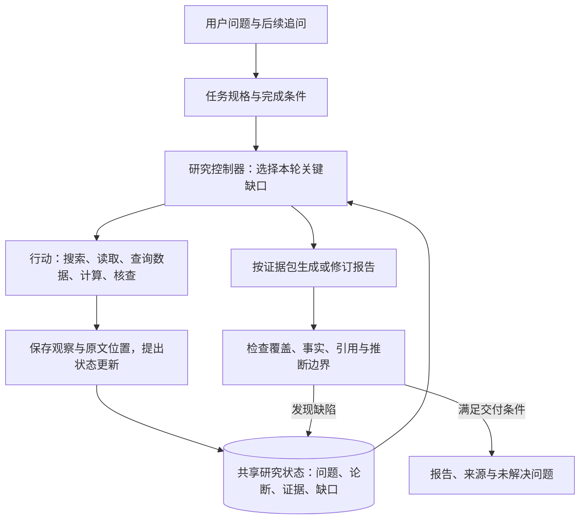

# Deep Research Agent 通用设计：围绕问题、论断、证据与缺口组织研究

**整理日期：** 2026-10-07；独立阅读与来源复核：2026-10-26。  
**主要依据：** [Lecture 10 综合笔记](Deep_Research_Lecture10_Integrated_Notes.md)及文末一手资料。课程原始资料入口见 [SOURCES.md](SOURCES.md)。法国教育研究情境仅作方法教学示例。

本文提出一套通用工程设计：让 Agent 持续判断“还有什么会改变答案的问题没解决”，选择合适的取证行动，并维护结论与证据的关系。以下对象、状态、调度规则和伪代码均为**工程建议**；引用的论文机制与实验边界另行说明，不能把它们当作这套组合架构已被验证的效果。

本文保留法国教育制度研究这一情境，用来演示前提核查、概念消歧、证据适用范围和因果边界。原始过程复盘未作为可独立访问的资料归档，因此以下情境统一视为教学构造，不据此确认法国政策、抗议或任何实际工具操作。理解本篇不需要阅读会话附件。

## 1. 从研究情境到可检验的设计需求

**建议把 Deep Research Agent 定义为：在给定范围和预算内，通过连续取证、检验与修订，完成一组研究问题并交付可追溯结论的系统。**

法国教育教学情境提出五类研究判断：首先核实问题前提；按概念依赖拆题；为每种论断选择适用来源；发现例外后收窄结论；将证据不足作为可表达的研究结果。课程材料为这些需求提供了方法背景：任务分类、迭代检索、状态压缩、检索意图、引用核验、评测和训练。具体机制见 [Lecture 10 综合笔记](Deep_Research_Lecture10_Integrated_Notes.md)第 2—4、9—11、14 章及[一手来源核查](Deep_Research_Agent_Design_Source_Checks.md)。

| 案例中的需求 | 课程材料补充的方法 | 建议落实的设计 |
|---|---|---|
| “最近、大规模、因为改革”本身待核实 | 任务约束与可检查的 rubric | 任务规格包含前提、时点和完成条件 |
| Bac、机构、项目被混为一谈 | 条件满足与候选核验 | 术语表、实体类型、问题依赖关系 |
| 权威来源只能证明它适用的事情 | 内容质量与引用支持分开评价 | 在论断与证据的连接上检查范围和支持程度 |
| 发现新材料会改变下一轮问题 | OpenScholar 反馈触发补充检索 | 用缺口驱动规划与局部修订 |
| 摘要可能丢失期间和限定词 | Tongyi 上下文管理、结构化状态 | 原文留存，按本轮需求重建工作上下文 |
| 多个研究分支可能复用同一来源 | 并行探索与综合分开 | 子任务返回证据包，主控制器统一合并 |
| 最后逐句核对范围、时间和因果 | Bench 系列的引用与内容评价 | 交付前核验，失败时返回对应缺口 |

推荐的初始架构如下。方框表示职责，不表示必须配置对应数量的模型或进程。



## 2. 先定义任务怎样完成，再确定研究深度

建议建立 `ResearchSpec`：研究目标、读者及用途、范围、截止时点、输出要求、预算、完成条件和待核实前提。只有会实质改变目标或证据需求的歧义才需要澄清；其他情况记录默认假设并开始研究。

例如，“法国人如何看待改革”至少有两种任务：整理主要群体的立场，或估计全国公众态度。后者需要具有适当抽样和问题设计的调查依据。系统应明确采用哪一种解释，不能用几则访谈悄悄完成任务替换。

同一个用户问题也可能包含不同类型的子任务。依据综合笔记第 2 章，建议分别设置验收方式：

| 子任务 | 交付对象 | 完成条件 |
|---|---|---|
| 单点事实 | 定义、数值、时间 | 对象、时点、口径正确，证据直接适用 |
| 多条件查找 | 一个或少数候选 | 各关键条件均有核验，不能以相关性代替满足性 |
| 集合发现 | 满足条件的一组对象 | 入选与排除有依据，并声明检索范围与遗漏风险 |
| 研究综合 | 比较、机制解释、判断 | 重要角度得到处理，前提、反证与不确定性可见 |

集合发现需要维护“候选 × 条件”矩阵；因果解释需要维护替代解释与可区分证据。这些任务可以共享控制器，但不应共享一个模糊的“资料已足够”判断。AutoResearchBench 的集合任务有指定语料边界；迁移到开放网络后，不能用预算耗尽证明不存在其他对象。[综合笔记 §2.4](Deep_Research_Lecture10_Integrated_Notes.md#chapter-2)

完成条件应描述要回答的内容，例如“区分改革前后规则、适用人群及生效时间”，而不是预设“证明改革导致抗议”。新发现可以增加必要检查项，但不应因材料不好找而删除原任务中的困难要求。

## 3. 建立共享研究状态，让每种对象承担明确职责

在案例提出的问题表、证据表、论断表基础上，建议显式增加任务规格和缺口队列，并保留来源版本与行动记录。

| 对象 | 保存什么 | 主要作用 |
|---|---|---|
| `ResearchSpec` | 目标、范围、时点、完成条件、预算、版本 | 保持研究方向稳定 |
| `Question` | 子问题、依赖、验收条件、关联论断、解决状态 | 判断任务覆盖 |
| `Source / Evidence` | 来源版本、访问状态、片段、位置、适用范围 | 回到实际读到的材料 |
| `Claim` | 一条具体陈述、类型、范围、支持与反对关系 | 管理哪些话可以怎样写 |
| `Gap` | 尚缺什么、为何重要、候选行动、阻碍与重试历史 | 决定下一步 |
| `Action / Artifact` | 工具调用、观察、状态版本、报告版本 | 恢复运行、诊断和复核 |

可以先用关系表或 JSON 实现这些关联。这里需要的是关系语义，不要求部署图数据库。

**证据是实际取得的材料，论断是对材料的解释。** “网页上有这段话”“该段支持这个判断”“该判断现实中可信”是三个不同检查。来源权威程度、片段支持程度、适用范围和独立性应分别记录，避免压成一个不透明的可信度分数。

一条建议的证据记录如下；字段值是占位示例，不是已核验的法国政策记录：

```json
{
  "evidence_id": "E12",
  "source_id": "D5",
  "source_version": "snapshot-or-content-hash",
  "url": "原始来源网址",
  "publisher": "发布主体",
  "published_at": null,
  "effective_at": null,
  "retrieved_at": "本次读取时间",
  "access_state": "body_excerpt",
  "locator": {"section": "原文小节", "page": null},
  "passage": "实际读取到的原文片段",
  "scope": {"entity": "具体对象", "period": "适用期间"},
  "provenance": {"derived_from": [], "independence": "unknown"},
  "limitations": ["不能据此推断所有项目均采用同一规则"]
}
```

日期未知就保留未知；发布日期、规则生效日期、事件发生日期和本次读取时间应分开。原始网页、工具返回文本和摘要也应分开标记，不能把部分返回缓存登记成完整页面快照。

论断应至少区分 `fact`、`attributed_view`、`calculation`、`inference`、`hypothesis`。观点的核验可以确认“某组织表达了这个观点”，却不能自动确认观点内容为真。计算结论需要输入证据 ID、公式、单位与舍入规则；分析结论需要前提、假设、反证和适用条件。

建议在 `Claim—Evidence` 关系上记录 `supports / contradicts / qualifies / context_only`，因为同一材料对不同论断的作用不同。对推断使用 `premise_claim_ids` 连接前提；不要把一个相关 URL 当成整条因果链的直接证明。

## 4. 规划保持两个层次：稳定目标与动态缺口

先构建少量关键问题与概念依赖，随后按证据逐步扩展。例如案例中可以先区分资格、机构与项目，再研究入口规则及改革影响。定义尚未厘清时，提前分发大量细分任务可能让各分支使用不同对象。

每轮行动建议回答四个操作性问题：

1. 本轮要解决哪个缺口？
2. 什么观察能确认、推翻或限定当前判断？
3. 为什么选这个来源和工具？
4. 如果失败，有什么替代动作或结束依据？

这些是可审计的任务说明，不要求保存模型未公开的内部推理。

调度可以先采用可解释的启发式：优先处理会改变主要结论、阻塞后续问题、且当前有可行取证路径的缺口；降低重复命中相同材料的任务优先级。成本要同时考虑调用费用、延迟、失败概率和后续审核成本。不要将未经校准的“信息增益 0.83”包装成精确概率。

| 当前缺口 | 合适的下一步 |
|---|---|
| 不知道正式名称或事件身份 | 广泛发现，补原文术语和实体别名 |
| 已有转述，缺原始依据 | 沿引用、公告或数据出处追溯 |
| 候选只满足部分条件 | 定向读取决定性段落、表格或附录 |
| 关键概括出现反例 | 核实范围，收窄或撤回论断 |
| 两份材料貌似冲突 | 先对齐对象、时间、状态和统计口径 |
| 因果解释缺少事件证据 | 寻找时间线、当事方材料或替代解释 |
| 没有新信息，只有相近查询 | 换来源或结束该分支，记录剩余限制 |

检索意图也应结构化，例如“全局目标＋已确认约束＋本轮缺口＋期望证据＋查询词”。AgentIR 研究了当前推理信息辅助检索；将它转成显式意图字段是工程迁移，不是论文原始接口，也不能保证未经训练的检索器获得相同收益。[AgentIR v3，§3.2、§5](https://arxiv.org/html/2603.04384v3)

需要保留一小部分探索空间：不仅补当前草稿里已知的缺口，也检查有没有遗漏重要群体、路径或替代解释。否则最初的错误问题树可能一直自洽，却始终遗漏真正重要的信息。探索触发条件可由重大结论形成、阶段结束或覆盖审查决定，无需机械设置搜索次数。

## 5. 工具负责取得观察，控制器负责解释与状态更新

建议提供边界清楚的工具：`search` 发现候选；`read` 定位原文；`query_data` 获取结构化记录；`calculate` 运行可复算计算；`resolve_evidence` 按 ID 回读材料；`checkpoint` 保存状态。

检索可以组合关键词、向量、站内查询、引用追踪和结构化数据接口，按任务选择。读取保留标题、小节、表格表头、脚注与页面位置；解析有疑点时定向回看页面图像。FinSearchComp 在课程材料中的作用，正是提醒时间、字段与单位错配本身就是任务失败。[综合笔记 §2.5、§11.5](Deep_Research_Lecture10_Integrated_Notes.md#chapter-11)

工具应返回可区分的 `OK / NO_MATCH / PARTIAL / TIMEOUT / ACCESS_DENIED / PARSE_FAILED`。403 只能说明本次访问受阻，不能证明内容不存在；只有摘要时，论断范围不能超出摘要提供的信息。重试、换源和升级读取方式都需占用同一任务预算。

LLM 适合提出问题、判断语义匹配、归纳论断、选择行动和组织解释；程序适合检查 ID 是否存在、预算与权限、数值计算、版本匹配和持久化。支持关系仍常需要模型或人工判断，JSON 合法不等于语义正确。

多来源也不自动意味着独立证据。建议记录原始发布者、转载关系、引用的数据集或研究。无法判断独立性时标记未知；三个网页引用同一调查，不应按三次独立测量累计支持强度。

## 6. 长任务的核心是保存依据，并使过时结论可失效

建议使用三层信息组织：

| 层次 | 内容 | 更新方式 |
|---|---|---|
| 原始材料 | 合法取得的文档、片段、表格与工具观察 | 按版本保留，不以摘要替换 |
| 研究状态 | 问题、论断、证据关系、缺口与行动记录 | 有版本地更新 |
| 工作上下文 | 当前任务、相关证据、必要术语、最近观察 | 每轮按需要重建 |

Tongyi 的 Context Management 使用演化中的报告与最近交互重建上下文；这支持“工作空间可以重建”的思路，不能保证任意摘要压缩都无损。这里提出的证据存储与状态分层是额外工程设计。[Tongyi v3，§3.1](https://arxiv.org/html/2510.24701v3#S3.SS1)

在此基础上，建议增加**变更传播**：如果证据版本更新、关键实体重新消歧，或一个前提被推翻，关联论断、计算和报告段落应标记 `needs_recheck`，不能只改一张证据表。保留旧版本用于追溯，完成复核后再生成新报告。

用户追问时同样处理：任务规格升版，比较新增范围与旧范围；满足新时点和适用条件的证据可以复用，其余重新核验。已有报告是可复用产物，不能被自动当成新的独立来源。

运行恢复应从检查点重建，按行动 ID 去重，避免重试生成重复证据。这里的“可复现”指能重建当时的输入、观察和判断依据；实时网站与模型输出仍可能变化，不能承诺完全相同的再次运行结果。

## 7. 多 Agent 作为可选执行策略，统一管理事实

当子问题可独立取证、共享前提较少、任务规模值得额外成本时再并行。案例中的“具体项目招生路径”与“改革作用范围”可以在术语对齐后拆开；同一项定义尚有歧义时，先处理依赖更合适。

建议子任务契约包含：`question_ids`、共享定义与已核实前提、来源要求、排除范围、预算、返回结构和停止条件。子任务返回新增证据、候选论断、反证、访问失败与剩余缺口；主控制器负责合并、去重、解决冲突和最终采用。

Anthropic 的官方研究系统文章支持对可独立分工的广度任务采用协调器与工作代理，并强调明确分工、引用和工程恢复。它是具体系统经验，不能把内部收益数字视为多 Agent 的普遍保证。[How we built our multi-agent research system](https://www.anthropic.com/engineering/multi-agent-research-system)

工程上可让工作代理只提交变更建议，由一个提交入口更新共享状态，减少互相覆盖。关键论断仍应回读原文；多数代理同意不能替代独立证据。是否使用不同模型，应通过错误互补性与成本实验判断。

## 8. 报告生成参与研究循环，核验必须有执行后果

可以在证据初步形成时生成论断提纲或短初稿，借它发现缺失比较与不成立的跳跃。OpenScholar 的反馈可触发新检索，并继续修订和检查引用；这为“草稿也是诊断工具”提供了实例。反思不保证每次改善，修订应保留前后版本。[OpenScholar，Inference: self-reflective iterative RAG；Data filtering](https://www.nature.com/articles/s41586-025-10072-4)

正式写作时，按章节提供证据包：本节回答的问题、可采用论断、对应片段、数字记录、反证、必须保留的限定词与未解决问题。最终报告的顺序服务于读者理解，不必复刻检索顺序。

引用建议先用内部 `claim_id → evidence_id → source_version + locator` 绑定，再解析为最终链接或脚注。润色后重新提取重要陈述做核对，以捕捉“部分”变“全部”、“计划”变“已实施”等变化。

审核结果应路由到具体修复动作：

| 缺陷 | 修复 |
|---|---|
| 缺少决定性材料 | 返回定向搜索或读取 |
| 引用支持范围小于陈述 | 收窄陈述，或另行补证 |
| 数字、单位、期间不一致 | 回到数据记录并复算 |
| 因果强度过高 | 补充经验依据，或明确为有条件推断 |
| 漏掉用户要求 | 恢复对应子问题，不能只加泛泛段落 |
| 无法解决的事实分歧 | 保留归属、分歧与对结论的影响 |

建议采用四种交付状态：`complete` 表示任务验收通过；`complete_with_limits` 表示已完成适当调查且准确表达证据限度；`budget_exhausted` 表示仍有应做工作但预算用尽；`blocked` 表示关键来源或环境阻断。不能仅因没找到答案而自动宣布“证据不足已查清”。

停止前检查核心问题覆盖、概念与范围稳定、重大反证得到处理、引用审核通过，并判断继续行动是否仍有合理价值。为综合与审核预留预算；如果审核不通过且预算已尽，交付应标明未验证部分或移除不支持的断言。

```python
spec = define_research_spec(request)
state = initialize_questions_and_dependencies(spec)
research_stop_reason = "budget_exhausted"
audit_status = "not_run"

while budget.allows_research(reserve_for_delivery=True):
    apply_pending_user_updates(state)       # 更新范围，并标记需要复核的旧状态
    gaps = assess_coverage_conflicts_and_support(state)
    action = choose_useful_action(gaps, state, budget)
    if action is None:
        research_stop_reason = classify_stop_reason(state)
        break
    observation = execute_with_limits(action)
    save_observation_and_access_state(observation)
    proposal = interpret_observation(observation, state)
    validate_and_commit(proposal, state)    # 结构检查与语义核验分开
    checkpoint(state)

draft = synthesize_from_evidence_packets(state)
while budget.allows_audit_or_repair():
    audit = audit_claims_and_task_coverage(draft, state)
    if audit.passed:
        audit_status = "passed"
        break
    audit_status = "failed"
    repair_state_or_draft(audit, state)      # 必要时重新取证；修复同样消耗预算
    draft = synthesize_affected_sections(state, draft)

status = derive_delivery_status(
    state, research_stop_reason=research_stop_reason, audit_status=audit_status
)
deliver(draft, status=status, unresolved=state.open_gaps)
```

这是流程示意，不是已经实现或测试的代码。`not_run`、`failed`和`passed`必须分别保留：审核预算为零、尚未审核不能推成通过；最后一次修复后没有复核，也仍不能记为通过。`classify_stop_reason`应区分关键问题解决、来源阻断与没有可行行动；`derive_delivery_status`要同时检查任务覆盖、未解决重大缺口和明确审核结果，不能只看循环是否结束。

## 9. 用法国教育案例走一遍状态变化

下面是教学构造的状态变化，不是实际研究执行日志，也不独立确认情境涉及的政策事实。

| 阶段 | 状态与行动 | 应防止的错误 |
|---|---|---|
| 收到问题 | 将事件是否近期、是否全国性、是否由改革触发列为待核实前提 | 一开始就接受用户因果解释 |
| 识别概念混淆 | 区分资格、机构、项目和招生入口，建立研究依赖 | 把一个学校的不同项目合并 |
| 查到平台覆盖多类课程 | 新增“平台覆盖是否等于规则一致”的缺口 | 由共用平台推断共用录取制度 |
| 查到项目差异 | 将宽泛论断拆成有对象、有条件的多个论断 | 将某项目规则推广到所有高商 |
| 得到学生组织声明 | 登记为有归属的诉求证据 | 直接写成全国公众意见 |
| 未找到适当公众调查 | 记录搜索范围与代表性缺口，必要时保留问题 | 将采访篇数当作代表性 |
| 形成机制解释 | 把制度事实与“资源短缺可能如何影响机会”的推断分开 | 将机制可行性当成已证实事件因果 |
| 写作与核验 | 按定义、路径、改革作用、解释边界组织 | 因制度事实可靠而放宽事件证据标准 |

该例最值得迁移的能力是：**研究成功也包括推翻前提、缩小论断和保留无法消解的分歧。** 验收条件应允许这些结果，不能奖励模型一律输出确定答案。

## 10. 通用流程与领域知识分开维护

建议用领域配置提供术语、实体类型、优先来源、证据要求、时间与数值口径、常见错误和审核样例。新领域主要增加这些配置，不必重写控制循环。

| 配置项 | 教育制度研究 | 企业经营研究 | 学术方法研究 |
|---|---|---|---|
| 基本对象 | 资格、机构、项目、招生入口 | 公司、业务、指标、报表口径 | 任务、方法、语料、实验配置 |
| 时间口径 | 公布、生效、适用学年 | 财年、自然年、累计期、单季 | 论文版本、训练与评测截止 |
| 关键证据 | 正式规则、项目页面、调查与当事方材料 | 披露、附注、结构化数据、可复算计算 | 方法、实验、消融、附录与代码 |
| 典型越界 | 一个项目代表全体系 | 一次性收益代表持续经营改善 | 一个基准成绩代表普遍能力 |

这些是证据适用性的配置示例，不是将某类来源无条件排在最高位置。官方表态可以证明官方立场，政策效果仍需要效果证据。

## 11. 评测、错误诊断与训练按顺序推进

建议从真实任务建立小型、人工检查过的评测集，包含证据充分、真正分歧、材料不足、日期变化、转载、部分解析和多轮追问。数量由预算与任务多样性决定，不预设一个通用合格样本数。

评价至少分开记录：任务覆盖、关键事实正确性、引用支持、需引证陈述的覆盖、分析边界、严重错误、时延与完整成本。按任务使用集合覆盖或条件满足指标；不要将“报告里现有句子都有引用”当成研究完整。

DeepResearch Bench II 用专家报告构建具体、原子化的内容要求，并分别评估信息、分析和呈现。可以借鉴这种粒度，但验收标准本身需要检查正确性和必要性，不能把模型生成的 rubric 当作真值。[Bench II v3，§3.1.2—3.1.3](https://arxiv.org/html/2601.08536v3#S3.SS1)

先比较三组基线：单轮检索生成；多轮搜索与阅读；多轮研究加结构化证据状态与核验。固定模型、预算、工具、数据版本和评测条件，记录成本与质量。然后用受控干预定位损失：

| 干预 | 想确认的瓶颈 |
|---|---|
| 人工提供必要原始证据 | 取得证据的困难是否占主要部分 |
| 固定候选，改变读取与重排 | 相关材料是否被正确选取和理解 |
| 固定证据与论断，只生成报告 | 综合、措辞或引用是否丢失正确状态 |
| 固定状态，比较下一步行动 | 规划是否持续追逐无关或重复信息 |
| 移除状态保存或核验 | 它们具体减少了哪些错误 |

BrowseComp-Plus 的 oracle retrieval 提供了正确证据注入的诊断实例；这些条件在真实上线时不可预先获得，不能当作部署成绩。[BrowseComp-Plus，§4.8.1](https://arxiv.org/html/2508.06600v1#S4.SS8.SSS1)

当错误定位清楚后，再选改进手段：检索失误先改查询意图、召回与重排；证据读错先改解析和阅读；状态丢失先改存储与加载；持续的行动策略问题才考虑轨迹 SFT。RL 需要可重复任务、可靠反馈、稳定工具环境和独立测试。

DR Tulu 的贡献之一是让开放式长报告获得随训练演化的 rubric 反馈。它支持“训练目标需覆盖长报告研究行为”的方向；不能据此把在线 Agent 自己修改完成条件等同于可靠训练，也不能让它为了过关降低用户要求。[DR Tulu v3，§2—3](https://arxiv.org/html/2511.19399v3)

## 12. 推荐的落地顺序与交付接口

第一阶段做一个研究控制器、上述核心对象、搜索与定向阅读、引用回查，以及预算和停止状态。先验证系统能否指出每个重要结论在回答什么问题、凭什么成立、适用到哪里。

第二阶段完善原文定位、内容版本、变更传播、重复检索检测、恢复运行和结构化计算，并以错误案例证明增量价值。

第三阶段按评测结果引入并行工作代理、意图重排或训练。单 Agent 下的证据模型如果仍然混乱，增加分支会增加合并与复核成本。

面向用户的交付建议包含主结论、关键依据、分歧与限制，以及必要的继续调查方向。执行过程中仅在范围变化、重要发现或受阻时提供有意义的进度。系统内部保留操作记录供审计，不必向用户倾倒全部调用日志。

文档和网页属于外部数据，不能修改工具权限或任务目标；私有来源的检索、缓存与输出应保持访问范围，计算工具隔离执行。这是系统边界设计，不是依赖模型阅读时自行判断的附加提示。

## 来源与核查入口

- **法国教育教学情境**：本文第 2、9、10 节给出问题、状态变化与证据边界；仅用于演示研究方法，不作为制度或事件事实来源。原始过程材料未归档，不列为可回查的研究证据。
- **课程综合笔记**：[Deep_Research_Lecture10_Integrated_Notes.md](Deep_Research_Lecture10_Integrated_Notes.md)，主要使用第 2—4、9—11、14 章。其参考编号见附录 D。
- **OpenScholar**：[本地原文 HTML](readings/001_OpenScholar.html)；[Nature 原文](https://www.nature.com/articles/s41586-025-10072-4)。2026-10-07的核查记录记载在线抓取受 cookie 跳转影响；2026-10-26复核使用仓库原文；见 Inference、Data filtering 与 Citation accuracy 小节。
- **AgentIR v3**：[本地 PDF](readings/006_AgentIR.pdf)；[原文](https://arxiv.org/html/2603.04384v3)。重点 §3.2 与 §5；全历史输入实验受上下文截断限制。
- **Tongyi v3**：[本地 PDF](readings/004_Tongyi_DeepResearch.pdf)；[原文](https://arxiv.org/html/2510.24701v3)。重点 §3.1、§4.3；上下文压缩与并行综合不保证证据完整保留。
- **DeepResearch Bench II v3**：[本地 PDF](references/010_DeepResearch_Bench_II.pdf)；[原文](https://arxiv.org/html/2601.08536v3)。重点 §3.1.2—3.1.3；端到端信息维度得分不等于检索器召回率。
- **BrowseComp-Plus v1**：[本地 PDF](references/003_BrowseComp-Plus.pdf)；[原文](https://arxiv.org/html/2508.06600v1)。重点 §4.8.1；oracle 只用于诊断。
- **DR Tulu v3**：[本地 PDF](readings/005_DR_Tulu.pdf)；[原文](https://arxiv.org/html/2511.19399v3)。重点 §2—3；训练反馈与本次运行的状态更新不同。
- **Anthropic 官方工程文章**：[本地原文归档](../../2680/readings/web/anthropic-com-engineering-multi-agent-research-system-a3afc1e8.html)；[How we built our multi-agent research system](https://www.anthropic.com/engineering/multi-agent-research-system)，2025-06-13；用于补充多 Agent 任务分工、引用与运行恢复经验，未使用其内部数字作效果承诺。
- **补充核查记录**：[Deep_Research_Agent_Design_Source_Checks.md](Deep_Research_Agent_Design_Source_Checks.md)。

本文未比较实时模型排行榜，未进行架构效果实验，也未更改课程原始资料。
