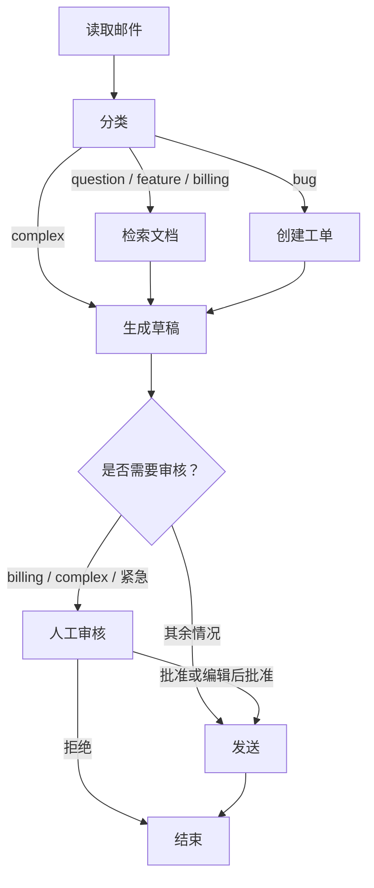
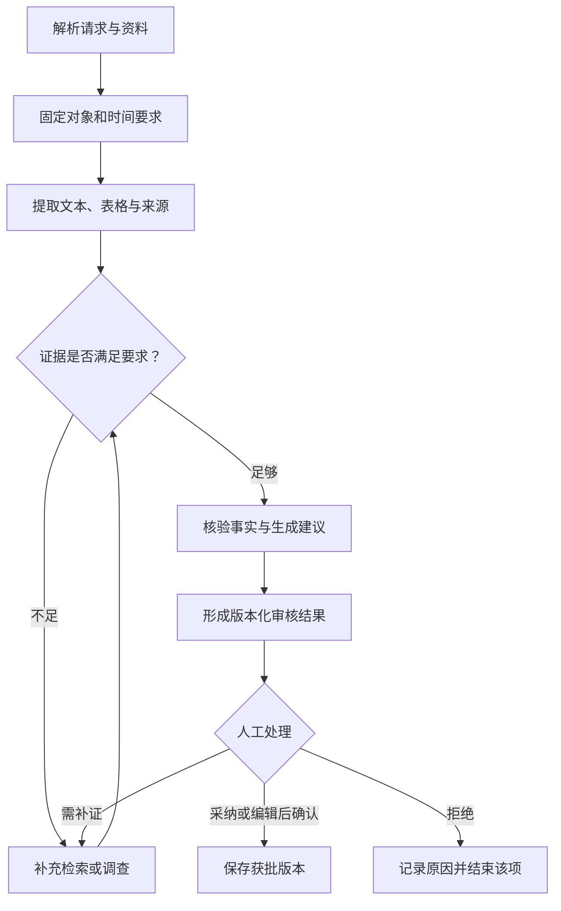
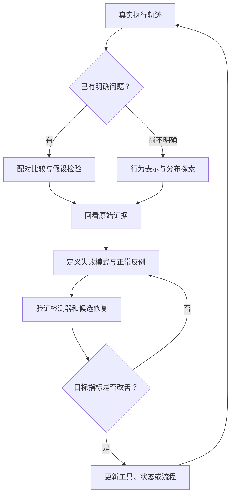

# Lecture 15：Orchestration and Monitoring
## 从可恢复执行到行为诊断：面向 LLM 开发工程师的完整讲义

> **主讲义**：Daniel Fried，CMU 11-768 AI Agents，Lecture 15，*Orchestration and monitoring*，2026-10-20。  
> **整理日期**：2026-10-23；全文复核：2026-10-26。  
> **读者**：具备 Python／Java 与后端开发经验，希望深入理解 Agent 编排、可靠性、评测和监控的 LLM 开发工程师。  
> **组织方式**：以 Lecture 15 的客服工作流为主线，将 Anthropic、LangGraph、Docent 与 Hodoscope 的机制、证据和工程含义连成一个完整系统。

本文要回答的核心问题是：

**怎样把模型的判断能力放进一个能够持续执行、可以恢复、可以验证，并能从真实失败中改进的系统？**

Orchestration（编排）规定系统允许怎样执行；monitoring（监控）帮助我们认识系统实际怎样执行。测试、评测和版本更新把两者连接起来。

这份文档围绕课程讲义组织解释、公式、代码示例和实验数据。资料原结论、教学例子和工程延伸分别说明。代码以机制演示为目的，省略的业务函数、模型客户端、权限控制与持久化配置需要在实际项目中补齐；本文不将这些片段声称为已运行验证的完整应用。

## 阅读导航

1. [课程地图：从模型调用到有状态执行系统](#ch01)
2. [编排模式：怎样分配固定逻辑与模型自由度](#ch02)
3. [贯穿案例：把客服需求推导成执行图](#ch03)
4. [State 与 Context：信息怎样在节点之间保持正确](#ch04)
5. [运行时：节点、并行、checkpoint 与持久执行](#ch05)
6. [失败语义：重试、中断、审核、外部副作用与预算](#ch06)
7. [可观测性：怎样记录足以诊断问题的 trace](#ch07)
8. [测试与评测：系统究竟获得了哪些保证](#ch08)
9. [Docent：怎样诊断一次模型升级后的性能下降](#ch09)
10. [Hodoscope 方法：怎样发现事先不知道的问题](#ch10)
11. [Hodoscope 实验：证据强度、消融和监控器退化](#ch11)
12. [投研与合规应用：从证据、审核到内网监控闭环](#ch12)
13. [框架选择与分阶段实施](#ch13)
14. [实践实验、排障顺序与复习问题](#ch14)
15. [附录 A：资料索引与讲义页码](#sources)
16. [附录 B：术语与容易混淆的概念](#glossary)

引用采用文内资料编号，例如 [L15，第 16 页](#ref-l15)、[R10](#ref-r10)。全部编号在附录 A 中解释；提供的网页链接是原始资料入口，资料内容以本次提供的附件快照与已经核对的官方文档为依据。未来库版本变化时，应重新确认相关 API 语义。

---

<a id="ch01"></a>
## 1. 课程地图：从模型调用到有状态执行系统

### 1.1 为什么模型很强，Agent 仍然可能失败？

设想用户发来一封邮件：

> “我这个月的订阅费被扣了两次，请调查，并退还多扣的钱。”

模型可能准确理解这句话，也能写出礼貌、流畅的回复，但任务成功仍依赖很多条件：

- 是否识别出这是账单问题？
- 是否查到适用政策？
- 是否查验了实际扣款？
- 是否把客户的主张误当成已确认事实？
- 是否声称执行了尚未执行的退款？
- 是否经过必要审核？
- 审核通过后发送的，是否就是审核过的那一版？
- 发送成功但进程崩溃，恢复时会不会重复发送？
- 任务耗尽时间预算后，是否给出明确状态与可理解结果？

这些问题跨越语义理解、数据证据、控制流、持久化、外部副作用和资源管理。因此，分析对象应是整个系统：

$$
\text{Agent 系统}
=
\text{模型}
+
\text{状态}
+
\text{工具}
+
\text{执行策略}
+
\text{运行环境}
+
\text{验证机制}
$$

这是本文的系统分析视角。它解释了为什么“换一个更强模型”并不能单独保证任务成功率上升。Lecture 15 后半部分的 Docent 案例会展示：新模型可能在某些子任务上表现更好，却在给定预算和执行环境中取得更差的总体成绩。

### 1.2 与 Skills、Planning、Automations 的关系

讲义第 2 页把本课放在此前的动作结构化方法之后。可以按照职责区分：

| 概念 | 主要问题 | 具体例子 |
|---|---|---|
| Skill | 某类局部任务怎样完成 | 查询账单、分析财报、修改代码 |
| Planning | 完成目标需要哪些步骤 | 先确认扣款，再检查退款资格 |
| Automation | 什么条件下启动或连接执行 | 收到邮件触发任务、每天定时生成摘要 |
| Orchestration | 步骤怎样共享状态、转移控制并处理失败 | 检索后保存结果、暂停等待审核、恢复后继续 |
| Monitoring | 实际执行是否偏离目标，偏离模式是什么 | 漏审、重复发送、超时、错误引用 |

成熟系统经常同时包含这些机制：外部工作流规定必要步骤，内部子任务允许动态规划，工具提供局部能力，监控持续检查真实行为。[L15，第 2—4 页](#ref-l15)

### 1.3 把 Agent 看成带不确定决策的有状态程序

一个方便的工程模型是：

1. 系统拥有当前任务状态；
2. 选择当前允许执行的步骤；
3. 步骤可以运行普通代码、调用模型或使用工具；
4. 根据结果更新状态；
5. 决定下一步；
6. 在完成、等待外部输入、预算耗尽或明确失败时停止当前执行。

模型是其中一种决策机制。外部数据也会变化，工具也会失败，所以即使固定 prompt，系统执行仍可能不完全相同。

编排需要同时关注两种性质：

**安全性质**：不应该发生的事情没有发生。例如，必须审核的文本没有在获批之前发出。

**进展性质**：在必要外部条件成立或明确超时后，任务能够继续推进，最终完成、拒绝或显式失败。等待人工的任务也需要明确的到期、取消或升级规则。

只关心第一种，系统可能永远停着；只关心第二种，系统可能“很顺利地完成了错误动作”。

这两个视角是对讲义的工程展开，有助于把“可靠”转成具体契约。

### 1.4 配套材料怎样补上讲义？

| 需要回答的问题 | 资料 | 关键贡献 |
|---|---|---|
| 哪些步骤固定，哪些交给模型？ | Anthropic《Building effective agents》 | 模式选择、复杂度控制、工具接口设计 |
| 如何把业务需求变成程序？ | Thinking in LangGraph、Workflows and agents | 步骤、状态、路由、动态任务与错误处理 |
| 暂停和崩溃后究竟发生什么？ | Persistence、Interrupts | checkpoint、thread、节点重执行和恢复 |
| 如何验证预期行为？ | LangGraph／LangChain Testing、LangSmith Evaluation | 确定性测试、模型评测、实验与回归 |
| 分数下降但原因未知怎么办？ | Docent 案例 | 成对轨迹比较、失败模式与统计验证 |
| 连问题类别都不知道怎么办？ | Hodoscope 论文与公告 | 行为表示、分布差异、审查排序与人工确认 |
| 怎样浏览大量表示和样本？ | Embedding Atlas | 向量、元数据与原始样本的交互探索 |
| 不同框架怎样表达执行？ | 各框架概览、讲义第 23 页 | 图、工具循环、对话协作与编码执行环境 |

整堂课的逻辑是：**设计执行结构 → 保存执行状态 → 记录实际行为 → 验证已知要求 → 诊断异常变化 → 发现未知模式 → 修改系统并重新验证。**

---

<a id="ch02"></a>
## 2. 编排模式：怎样分配固定逻辑与模型自由度

Anthropic 将 workflows 与 agents 区分为两种控制方式：前者主要沿开发者预先定义的路径执行，后者由模型动态决定更多步骤和工具使用。实际系统可以混合使用。它提出的模式，是分配决策自由度的方法。[R01](#ref-r01)

### 2.1 Prompt chaining：用可检查的中间结果连接阶段

例如：

> 提取请求事实 → 检索政策 → 判断适用条件 → 生成回复。

阶段变窄后，提示词目标更清楚，中间结果也更容易检查。但收益取决于阶段之间传递什么。

如果第一个节点输出：

```text
客户被重复扣款，需要退款。
```

它把“客户的主张”升级成了“已验证事实”。下游可能完全按这句话正确推理，却产生错误结果。

更稳健的中间结果是：

```json
{
  "customer_claim": "本月被重复扣款",
  "claim_verified": false,
  "requested_action": "退还多扣金额",
  "required_evidence": [
    "实际扣款记录",
    "适用退款政策"
  ]
}
```

链式编排的工程价值，在于每一步建立了什么契约：

- 输出必须包含哪些字段？
- 哪些字段是原始证据，哪些是推断？
- 信息丢失怎样被发现？
- 下一步允许假设什么？
- 无法完成时怎样表达？

JSON Schema 可以检查结构，但不能证明字段内容真实。包含 `citation` 字段，也不能证明被引用资料支持结论。

在投研场景中，可以将“数据提取 → 期间与单位检查 → 确定性计算 → 文字解读”分开。这里普通代码检查的价值，来自它与模型生成具有不同的失效方式。

### 2.2 Routing：预测错误会改变保护路径

Lecture 15 中，分类结果决定后续执行分支。

需要分别验证两个问题：

1. 给定分类结果，程序是否进入正确分支？
2. 模型是否正确识别真实类别？

程序可能保证：

$$
\text{预测为 billing}\Rightarrow\text{进入审核}
$$

业务关心的却是：

$$
\text{真实账单问题}\Rightarrow\text{进入审核}
$$

第一条可以用固定输出的节点测试保护；第二条还依赖分类召回率和真实输入分布。讲义第 8 页明确提醒审核路径依赖分类结果。[L15，第 8 页](#ref-l15)

总体准确率可能掩盖关键类别漏检。假设绝大多数邮件都是普通问题，把所有邮件都判为普通问题也可能获得很高的总体准确率。

因此，应同时关注：

- 必须审核类别的召回率；
- 真实需要审核但被免审的比例；
- 不确定输入如何处理；
- 哪些可信业务信号可以直接触发审核；
- 最终副作用节点能否验证必要的前置条件。

路由把语义预测转成控制流程。错误成本分析因此成为编排设计的一部分。

### 2.3 Parallelization：拆分任务与多次判断有不同假设

#### Sectioning：并行完成相对独立的任务

处理重复扣款时，可以并行查询支付记录、退款政策和历史沟通记录。

并行结果必须对齐同一个用户、订单、时间范围和版本。在财务分析中，收入、利润和现金流可以分别提取，但合并前要统一主体、报告期、币种和合并范围。

并行节省的时间大致来自独立任务的重叠，实际还要考虑排队、限流、同步和整合成本。不能把并行子调用耗时简单相加作为用户等待时间。

#### Voting：通过多次判断降低错误

假设三个二元判断器的错误率均为 $q$，且错误相互独立。多数投票错误概率为：

$$
P_{\text{majority error}}
=3q^2(1-q)+q^3
=3q^2-2q^3
$$

若 $q=0.2$，结果为 $0.104$。这是教学推导，不是实际模型测量。

但当三个判断器依赖同一份错误证据，使用相同模型与相似提示词时，错误可能高度相关。极端情况下，它们总是一起犯错，投票就没有收益。

增加 Agent 前，应判断新增模块是否提供了不同证据、不同检查方式或不同失效模式，而不只计算调用次数。[R01](#ref-r01)

### 2.4 Orchestrator–workers：动态展开任务结构

固定并行适合预先知道子任务数量和类型的情况。对于“调查过去三个月多次扣款异常的原因”，系统可能需要根据输入动态确定要检查的订单和支付渠道。

LangGraph 的参考资料用 `Send` 展示运行时分配 worker 输入、再汇总结果的方法。[R03](#ref-r03)

动态拆分增加三类风险：

| 风险 | 典型表现 | 设计方向 |
|---|---|---|
| 覆盖风险 | planner 没有生成必要子任务 | 明确任务覆盖标准，检查遗漏 |
| 上下文风险 | worker 缺少背景或时间要求 | 为每个 worker 建立完整任务契约 |
| 整合风险 | 子结果冲突，汇总时直接拼接 | 显式保留来源、冲突和未解决问题 |

一个 worker 任务至少应说明：

```text
subtask_id
对象与时间范围
需要回答的问题
允许使用的数据快照
必须返回的证据与来源
输出结构
预算与终止条件
```

任务汇总不是列表拼接。它需要检查实体、时间、单位、证据之间的关系。

### 2.5 Evaluator–optimizer：反馈必须能改变下一步行动

这种模式让生成器产出结果，评估器提出问题，再由生成器修改。

“还不够专业”很难指导下一步。

“回复声称退款完成，但没有退款流水；请取得真实回执，或者删除完成性承诺”则能直接指导行动。

适用前提是：

- 有相对明确的评价标准；
- 反馈足够具体；
- 修订有机会解决问题；
- 循环存在终止与预算约束。[R01](#ref-r01)

建议在循环状态中保存：

- 尚未解决的问题；
- 本轮新增证据；
- 已尝试的修订；
- 当前草稿版本；
- 剩余时间与调用预算。

生成器和 judge 可能共享同一误解，也可能反复修改措辞却没有新增事实。若多轮迭代没有取得证据或消除错误，应进入明确的升级、人工处理或无法完成状态。

### 2.6 Agent loop：在固定边界内允许探索

Agent loop 根据工具观察动态选择下一步行动，适合路径难以预先穷举的任务。

模型决定停止调用工具，只能说明它停止了当前循环。业务完成仍然需要外部标准，例如文件实际生成、数据验证通过、审批完成和动作回执存在。

一个实用组合是：

- 外层固定读取、分类、证据检查、审核、发送；
- 复杂调查节点内部允许规划和工具循环；
- 独立数据查询并行执行；
- 草稿通过有限次数的检查与修订；
- 最终动作执行确定性前置条件检查。

图可以包含循环和动态分支，不应把所有 Agent 图都理解为一次性的 DAG。

### 2.7 工具设计是编排设计的一部分

Anthropic 的工具设计附录强调：接口需要适合模型使用，包含清楚的名称、边界、例子和错误反馈。其编码案例中，相对路径随工作目录变化造成问题，改用绝对路径消除了一类系统性错误。[R01，附录 2](#ref-r01)

这提示了一条重要的修复路径：

> trace 发现错误参数模式 → 识别接口歧义 → 改造工具契约 → 用原失败案例验证。

有时，明确日期范围、对象 ID 和单位，比继续追加自然语言提醒更有效。第 12 章会把它用于基金收益工具设计。

---

<a id="ch03"></a>
## 3. 贯穿案例：把客服需求推导成执行图

### 3.1 先限定业务完成标准

Lecture 15 演示的是客服邮件处理工作流，没有完整实现查验扣款、认定退款资格和执行退款的系统。

因此应区分：

- 处理并回复邮件；
- 查明账单事实；
- 批准退款；
- 执行退款；
- 确认用户问题解决。

如果产品目标包含真正退款，就需要额外的证据、授权、动作接口和回执节点。不能因为草稿写了“已退款”，就认为业务动作已经发生。

### 3.2 采用讲义中的路由版本

讲义第 7—10 页的路径是：



本文坚持这一课堂路径。`Thinking in LangGraph` 网页示例的某些分支不同，不能把两个版本的片段拼成一个声称完整一致的官方实现。[L15，第 7—10 页](#ref-l15)；[R02](#ref-r02)

### 3.3 每一步建立了什么事实？

| 执行阶段 | 新增信息 | 还需要证明的内容 |
|---|---|---|
| 读取邮件 | 客户声称重复扣款 | 实际是否重复扣款 |
| 分类为 billing | 模型认为这是账单问题 | 分类是否正确 |
| 检索政策 | 得到可能相关的政策 | 是否适用于该客户和订单 |
| 生成草稿 | 得到拟发送文本 | 文本中的事实和承诺是否有依据 |
| 人工批准 | 某人同意某一版本 | 外部动作是否执行 |
| 发送成功 | 发送服务接受了请求 | 退款是否完成，问题是否解决 |

这张表体现了状态建模中的认识边界：

- 原始主张；
- 模型判断；
- 外部证据；
- 提案；
- 审核决定；
- 执行回执；

需要保留各自身份。将它们混在一段叙述中，容易把推断误写成事实。

### 3.4 用五步法从需求走向代码

`Thinking in LangGraph` 的设计过程可以整理为：

1. **映射业务步骤**：根据任务成功条件拆分阶段；
2. **识别操作类型**：模型、数据、外部动作、人工输入；
3. **设计状态**：保存跨节点信息与值得保留的结果；
4. **实现节点**：输出状态更新并明确错误语义；
5. **连接控制流**：建立边、分支、停止条件与持久化。[R02](#ref-r02)

不同操作类型虽然都可能表现为 API 调用，但失败含义不同：

| 类型 | 示例 | 首要设计问题 |
|---|---|---|
| 模型操作 | 分类、草稿 | 不确定性、语义质量、结构约束 |
| 数据操作 | 检索政策、读取账单 | 版本、空结果、超时与证据来源 |
| 外部动作 | 发邮件、创建工单 | 授权、幂等、回执与重复执行 |
| 人工输入 | 审核、补充信息 | 暂停、恢复、到期与版本对应 |

### 3.5 用执行记录检查业务语义

以 billing 邮件为例，合理的执行账本应能够回答：

| 顺序 | 状态变化或事件 | 恢复后应维持的含义 |
|---|---|---|
| 1 | 保存原始邮件及其 ID | 后续引用同一请求 |
| 2 | 保存分类结果 | 路由依据可以追溯 |
| 3 | 保存检索结果与来源版本 | 生成重试可复用相应证据 |
| 4 | 保存草稿版本与内容哈希 | 审核对象稳定 |
| 5 | 发出人工审核中断 | 当前 invocation 暂停，尚未发送 |
| 6 | 接收对该版本的决定 | 决定与具体内容对应 |
| 7 | 发送并保存动作回执 | 可查验实际外部效果 |

这里已经把 orchestration、persistence、approval 和 trace 连接起来了。它们描述的是同一个业务执行过程的不同侧面。

---

<a id="ch04"></a>
## 4. State 与 Context：信息怎样在节点之间保持正确

### 4.1 State 是任务的事实与控制信息

讲义中的 state 包含 `email_id`、`email_content`、`classification`、`search_results`、`draft_response`、`review_decision` 等字段。[L15，第 11—12 页](#ref-l15)

在生产场景中，可以按语义分成六组：

| 分组 | 典型内容 |
|---|---|
| 原始输入 | 请求、对象 ID、附件引用 |
| 模型判断 | 分类、任务分解、明确的不确定项 |
| 外部证据 | 数据值、来源、时间、单位、版本 |
| 待执行提案 | 草稿、建议、计划动作及版本 |
| 授权与审核 | 决定、审核对象版本、审核身份引用 |
| 执行与控制 | 回执、尝试次数、剩余预算、终止原因 |

这是一种工程设计建议，不是要求每个项目使用固定字段名。

### 4.2 保存结构化原始信息，再构造节点上下文

参考资料建议保存跨节点需要的原始数据和昂贵结果，而不是只保存已经拼好的 prompt。[R02](#ref-r02)

可以把节点输入表示为：

$$
\mathrm{Prompt}_i
=
\mathrm{Template}_{i,v}
+
P_i(\mathrm{State})
$$

$P_i$ 是第 $i$ 个节点的上下文选择函数。

审核节点可能需要原始请求、当前草稿、证据与风险信息；它通常不需要完整保留每次工具重试的报错文本。对大型附件，可以保存不可变引用、内容哈希和相关证据切片。

这种分离有三个作用：

1. 同一份数据可以服务不同节点；
2. 模板变化不必破坏事实层；
3. 可以检查信息是在 state 中丢失，还是在上下文选择阶段丢失。

### 4.3 State 正确，模型输入仍然可能错误

假设提取结果是：

```json
{
  "value": 0.12,
  "unit": "ratio",
  "period_type": "calendar_year",
  "period_start": "2025-01-01",
  "period_end": "2025-12-31",
  "source_ref": "report-v3-table-8"
}
```

但传给模型的压缩文本变成：

```text
收益：12%。
```

模型最终可能写成“近一年收益 12%”。

原始提取、数据库与 state 都可能正确，错误发生在上下文投影中。为诊断这种错误，trace 需要记录实际模型输入或能重建该输入的上下文清单，不能只记录上游 state。

这与长任务中的“前半段正确，后半段期间混淆”直接相关：压缩、摘要和跨载体改写都应视为需要验证的信息变换。

### 4.4 类型约束与语义约束分开建立

`TypedDict` 有助于静态类型检查；运行时校验工具可以检查字段和类型；结构化输出可以减少格式错误。

但这些机制都不会自动证明：

- 值来自正确报告期；
- 所引条款实际适用；
- 草稿没有越过证据边界；
- 审核决定对应当前版本。

因此，可以把数据契约分成：

- **结构约束**：字段、类型、枚举；
- **领域约束**：日期先后、对象一致、单位一致；
- **证据约束**：值与来源相符；
- **执行约束**：特定动作的前置条件成立。

### 4.5 明确表达“没有结果”和“没有完成”

下面两种结果应保持不同：

```json
{"status": "ok", "results": []}
```

```json
{"status": "error", "error_type": "timeout"}
```

第一种说明检索完成但没有命中；第二种说明检索没有完成。

如果把两者都降为一个空列表，下游无法判断应该更换查询、重试服务，还是承认证据不足。后续监控也无法正确计算“无结果率”和“依赖故障率”。

状态中的错误语义，会直接决定控制流和监控语义。


---

<a id="ch05"></a>
## 5. 运行时：节点、并行、checkpoint 与持久执行

### 5.1 节点返回更新，运行时执行合并与调度

可以把节点抽象为：

$$
u_t=f_{n_t}\big(P_{n_t}(s_t),\mathrm{environment}\big)
$$

运行时按照字段规则合并更新：

$$
s_{t+1}=R(s_t,u_t)
$$

其中：

- $s_t$：当前状态；
- $P_{n_t}$：该节点的输入选择；
- $u_t$：状态更新；
- $R$：合并规则；
- 路由逻辑：决定下一步执行位置。

讲义中的节点 patch 和 `Command(update=..., goto=...)` 对应这个过程。[L15，第 12—15 页](#ref-l15)

### 5.2 并行时，reducer 是程序语义的一部分

假设两个 worker 同时向 `evidence` 写结果，需要明确：

- 两个列表怎样合并？
- 重复证据怎样处理？
- 冲突信息怎样保留？
- 证据顺序是否有业务含义？
- 同一来源的不同版本是否允许共存？

LangGraph 中，并行节点在同一步更新同一字段，没有合适 reducer 时可能报冲突；不要假设它一定使用最后写入覆盖。

`Annotated[list, operator.add]` 这类 reducer 只表示列表拼接。它不自动保证去重、跨版本一致性或业务顺序。对需要确定性的聚合，应保存稳定 ID，明确排序和冲突处理规则。[R03](#ref-r03)；[W02](#ref-w02)

**Reducer 解决状态怎样合并，业务代码还要解决信息怎样融合。**

### 5.3 节点边界影响失败后重做多少工作

讲义第 16 页说明：先保存检索结果，再生成回复，生成失败时就可以保留前序工作。[L15，第 16 页](#ref-l15)

用一个简化模型理解节点划分。

设：

- 稳定步骤 A 的成本为 $a$；
- 易失败步骤 B 每次成本为 $b$；
- B 每次独立失败概率为 $p<1$；
- 拆分后增加一次保存成本 $h$；
- 假设重试直至成功，每次失败也花费完整的 $b$。

A、B 合在同一个重执行单元中：

$$
E[T_{\text{合并}}]=\frac{a+b}{1-p}
$$

先持久化 A，再重试 B：

$$
E[T_{\text{拆分}}]=a+\frac{b}{1-p}+h
$$

期望节省为：

$$
\frac{ap}{1-p}-h
$$

教学例子取 $a=30$ 秒、$b=10$ 秒、$p=0.2$、$h=0.5$ 秒，得到：

| 方式 | 期望耗时 |
|---|---:|
| 合并重做 | 50 秒 |
| 保存 A 后只重做 B | 43 秒 |

这不是实测结果；真实系统还存在有限重试、相关故障、不同失败耗时和并发开销。

它揭示了一条工程原则：昂贵、稳定、已经取得的结果，值得放到可恢复边界之前。反过来，廉价纯函数没有必要全部拆成图节点。

### 5.4 区分四种持久信息

| 概念 | 含义 | 不应自动推断的内容 |
|---|---|---|
| State | 当前任务的业务与控制信息 | 不必是全部历史文本 |
| Checkpoint | 某个执行边界的可恢复记录 | 不代表外部世界能够回滚 |
| Thread | 关联多次调用的持久执行上下文 | 不等于系统线程、trace 或用户身份 |
| Store | 可跨任务或 thread 使用的持久信息 | 不等于当前任务的执行游标 |

同一个用户可以同时发起多个任务；这些任务通常应有独立 thread。首次运行、人工恢复和故障恢复则需要正确关联相应任务。[R04](#ref-r04)

`InMemorySaver` 适合演示与部分测试。需要跨进程恢复时，应使用相应持久化后端，并验证真实故障条件下的数据可恢复性。

### 5.5 Superstep、并行结果与 checkpoint

普通 Graph API 的完整 checkpoint 通常围绕执行步骤边界建立，不会自动保存 Python 函数中每一行的位置。

同一步中并行运行的节点结束后，运行时合并更新并继续调度。若同一步的某个任务失败，已经完成任务的 pending writes 可以被保存，以减少恢复时无谓重做。[R04](#ref-r04)

这不意味着每个外部动作都获得跨系统事务保证。持久状态与外部世界之间仍有需要处理的窗口。

### 5.6 写入时机影响恢复承诺

官方文档区分不同持久化时机：

| 模式 | 主要行为 | 工程含义 |
|---|---|---|
| `sync` | 保存完成后再继续下一步 | 更强的步骤间持久保证，增加同步等待 |
| `async` | 保存与下一步执行重叠 | 降低同步开销，存在相应崩溃窗口 |
| `exit` | 执行退出时保存，包括正常结束、错误和中断等 | 无法依靠尚未保存的中途进度应对进程崩溃 |

选择时应说明“在哪个边界后崩溃能恢复什么”，而不是只写“支持持久化”。[W03](#ref-w03)

### 5.7 可恢复边界也可以位于节点内部

官方文档支持在节点内部使用持久任务：配置 checkpointer 且任务结果已成功记录后，恢复时可以复用结果，避免重新执行已完成任务。[W02](#ref-w02)

Functional API 还允许通过 `@entrypoint`、`@task` 等机制结合普通 Python 控制流表达工作流，与 Graph API 使用相同底层执行机制。[W04](#ref-w04)

两点需要一起理解：

- 不必把所有局部操作都画成图节点；
- 函数内部的重执行与任务结果复用仍然有精确语义，需要按对应 API 设计。

无论使用哪种 API，如果外部副作用已经发生但完成记录尚未持久化，仍要面对下一章的幂等问题。

---

<a id="ch06"></a>
## 6. 失败语义：重试、中断、审核、外部副作用与预算

### 6.1 Retry、resume、replay 分别是什么？

| 操作 | 含义 | 示例 |
|---|---|---|
| Retry | 对失败步骤再次尝试 | 检索服务暂时超时后重试 |
| Resume | 从保存的执行状态继续 | 审核人批准后恢复任务 |
| Replay | 从历史 checkpoint 出发重新执行后续过程 | 重放某个失败案例，尝试新路径 |
| Semantic revision | 根据反馈改变输入或策略后再执行 | 修正工具参数、换查询词、补充证据 |

原样重试通常适合暂时故障；语义错误往往需要改变请求。不能把“同一个错误 prompt 再调用三次”自动解释为有效恢复。

Replay 还会遇到外部世界变化：数据源修订、模型升级、工具变化和用户后续操作。需要复现历史问题时，应固定或记录相应版本与快照。

### 6.2 按失败类型选择恢复方式

| 失败类型 | 合理处理方向 | 容易发生的错误 |
|---|---|---|
| 网络波动、暂时限流 | 有界重试、退避和抖动 | 无上限重试使故障扩大 |
| 参数有可修正错误 | 结构化报错，让模型修正 | 直接吞掉错误并继续生成 |
| 缺少用户信息 | 中断等待补充 | 猜测必要事实 |
| 检索完成但没有证据 | 补充检索、限制结论或显式无法完成 | 将空结果当成支持性证据 |
| 程序错误或状态破坏 | 暴露错误并定位 | 伪装成正常空响应 |
| 外部动作结果未知 | 查询回执、对账，再决策 | 盲目重新执行不可去重动作 |

这延伸了 `Thinking in LangGraph` 对暂时故障、模型可修正错误、需要用户补充以及未知错误的区分。[R02](#ref-r02)

### 6.3 人工中断不会冻结整个 Python 栈

LangGraph 的动态 `interrupt()` 在恢复时，会使包含中断的节点从头执行，再把恢复值交给相应中断位置。[R05](#ref-r05)

下面的教学代码存在版本错配：

```python
def draft_and_review(state):
    draft = llm.invoke(build_prompt(state)).content

    approved = interrupt({"draft": draft})

    if approved:
        return {"approved_text": draft}
```

第一次执行：

1. 生成草稿 A；
2. 展示 A；
3. 暂停。

审核人批准 A 后恢复：

1. 节点重新开始；
2. 模型可能生成草稿 B；
3. 对 A 的批准成为恢复值；
4. 代码把 B 视为已批准。

真正的问题是审核决定失去了稳定的业务对象。

### 6.4 让批准绑定持久化的提案

一个稳健的设计是：

1. 生成节点输出草稿；
2. 保存草稿版本、内容与哈希；
3. 独立审核节点展示这一版本；
4. 审核决定记录相应版本；
5. 发送节点验证批准仍对应当前内容；
6. 编辑产生新版本，按业务规则重新确认批准关系。

对需要审核的内容，业务约束可以表达为：

$$
\mathrm{requires\_review}(d)\land\mathrm{send}(d)
\Rightarrow
\mathrm{valid\_approval}\big(\mathrm{hash}(d)\big)
$$

下面只展示需要人工审核分支的职责划分，依赖函数与数据结构由项目实现。普通请求是否免审，由前面的业务规则决定：

```python
def draft_node(state):
    text = generate_draft(state["evidence"])
    return {
        "draft": build_versioned_draft(text)
    }


def review_node(state):
    draft = state["draft"]

    decision = interrupt({
        "draft_id": draft["id"],
        "draft_hash": draft["hash"],
        "text": draft["text"],
    })

    return {
        "review": bind_review_to_draft(decision, draft)
    }


def send_node(state):
    draft = state["draft"]
    review = state["review"]

    # 同时校验批准状态、审核权限、草稿版本和内容哈希。
    assert_review_matches_current_draft(review, draft)

    receipt = send_with_stable_operation_id(
        operation_id=state["send_operation_id"],
        text=draft["text"],
    )

    return {"send_receipt": receipt}
```

这个例子解释了讲义为什么把草稿和审核分成不同阶段：节点边界同时服务于信息保存、恢复行为和业务正确性。

### 6.5 部署变化也可能破坏等待中的任务

节点内部任务与中断的重放可能依赖调用顺序。对尚未完成的持久任务部署新代码时，改变任务／中断顺序可能造成已有结果与新代码位置不匹配。[R05](#ref-r05)；[W02](#ref-w02)

工程上应考虑：

- graph 与 state schema 版本；
- 等待中的任务如何继续执行；
- 旧版本任务是否使用兼容执行器；
- 状态迁移是否有明确规则；
- 审核页展示的版本是否仍可解析。

这对等待数小时或数天的人工流程尤其重要。

### 6.6 外部成功与本地持久化之间存在窗口

考虑一个发送操作：

1. 接收方接受发送；
2. 外部效果已经发生；
3. 本地进程在保存回执前崩溃；
4. 任务恢复；
5. 再次调用发送函数。

Checkpoint 无法单独关闭这个跨系统窗口。

比较实用的机制包括：

- 首次尝试前建立稳定的 `operation_id`；
- 同一逻辑操作重试时沿用该 ID；
- 接收方实施原子去重或唯一约束；
- 保存可查询回执；
- 对未知结果进行对账；
- 区分“确定失败”与“结果尚不明确”。

这里需要验证的是**业务效果只发生一次**，调用函数本身可能运行两次。

仅把函数命名为 `send_once`，或者执行一次“先查再写”，不能证明并发下不会重复。事务 outbox 可以保存动作意图并改善交付可靠性，但接收方仍需要与重试相适应的去重语义。

这与消息系统中的重复消费问题可以类比：执行尝试次数与业务效果次数是不同指标。

### 6.7 动态路由不会自动取消静态边

下面的配置可能同时安排发送和审核：

```python
graph.add_edge("draft", "send")

# draft 节点又返回：
return Command(goto="review")
```

官方文档明确指出，`Command(goto=...)` 不会覆盖已定义的静态边。[W02](#ref-w02)

因此，一个“节点返回 review”的单元测试不能证明整个图不会发送。完整测试必须验证：

> 在有效批准之前，外部发送效果为零。

人工中断也不是已经发生的外部副作用的回滚机制。

### 6.8 预算应该进入执行状态

单节点最多重试三次，不能阻止整个图在多个节点之间绕圈。

建议区分：

- 总任务截止时间；
- 总 token／成本预算；
- 工具调用预算；
- 子任务预算；
- 模型修订次数；
- 人工等待期限。

还应保存明确终止原因，例如：

```text
completed
rejected
waiting_for_review
budget_exhausted
dependency_failure
invalid_state
cancelled
```

具体枚举由产品决定。等待审核是任务状态，不应被粗暴计入模型失败；预算耗尽则要结合业务成功定义解释。

预算观测和预算控制是两个环节：先记录剩余资源与耗时分布，再让 planner 或路由根据它们改变行动。Docent 案例将说明这种闭环为什么重要。

---

<a id="ch07"></a>
## 7. 可观测性：怎样记录足以诊断问题的 trace

### 7.1 设计图与执行轨迹分别回答什么？

图描述允许的执行结构；trace 记录某一次实际执行。

在本课语境下可以这样分工：

- **Logs／events**：具体事件与诊断细节；
- **Metrics**：次数、比例、延迟和成本等聚合信号；
- **Traces**：操作之间的嵌套、因果和时序关系；
- **Monitoring**：利用这些信号持续检查已知问题、发现异常；
- **Evaluation**：在明确任务与评价标准下估计系统质量。

这些能力可以由一个平台提供，也可以分布在多个组件中。选择产品之前，应先明确需要保留哪些事实和关系。

### 7.2 一个业务任务可能跨多个 trace

Lecture 15 使用 LangSmith 的术语：操作形成 run，嵌套执行树构成 trace。账单例子展示了人工暂停前与恢复后的调用。[L15，第 18—19 页](#ref-l15)

工程上建议区分：

| 标识 | 用途 |
|---|---|
| `task_id` | 关联整个业务任务 |
| `thread_id` | 关联持久执行上下文 |
| `trace_id` | 标识某次 invocation 的轨迹 |
| `span_id / parent_span_id` | 描述调用层次 |
| `checkpoint_id` | 标识保存与恢复位置 |
| `operation_id` | 对应外部业务动作 |
| `artifact_id / version` | 对应草稿、报告等业务产物 |

跨暂停恢复时，可以显式保存 `resume_from_trace_id` 等关联。不要假设所有平台自动把跨进程、跨人工等待的调用呈现为一棵完整树。

### 7.3 普通代码也要进入 trace

一个最终事实错误可能发生于：

- OCR／表格解析；
- 检索过滤；
- 单位转换；
- 上下文裁剪；
- 日期计算；
- state 合并；
- 最终模板渲染。

如果只记录模型请求与回答，会遗漏真正的根因。

官方 LangSmith 支持用 `@traceable` 包装普通 Python 函数并关联嵌套调用。下面只展示 instrumentation 形式，业务实现和模型客户端集成省略。[W01](#ref-w01)

```python
from langsmith import traceable


@traceable(run_type="tool")
def retrieve_policy(query):
    return search_backend(query)


@traceable
def validate_evidence(evidence):
    return check_dates_units_and_sources(evidence)


@traceable
def prepare_draft_context(case):
    evidence = retrieve_policy(case["query"])
    checks = validate_evidence(evidence)

    return {
        "case": case,
        "evidence": evidence,
        "checks": checks,
    }
```

内网环境可以使用相应本地 instrumentation 与存储。真正需要迁移的是输入、输出、时序与关联关系，并不要求将业务数据发送到特定云服务。

### 7.4 最小但有诊断价值的数据模型

下面是工程示例，不是某个框架的固定数据库 schema：

```text
runs
  task_id
  thread_id
  trace_id
  task_family
  model_version
  graph_version
  prompt_version
  started_at
  ended_at
  termination_reason
  business_result

spans
  trace_id
  span_id
  parent_span_id
  operation_type
  operation_name
  attempt
  input_ref
  output_ref
  started_at
  ended_at
  error_type

events
  task_id
  trace_id
  event_type
  checkpoint_id
  artifact_id
  artifact_version
  decision
  operation_id
  external_receipt_ref
```

另外可保存：

- 数据源和索引版本；
- 模型实际收到的上下文清单；
- 证据页码、表格、坐标与内容哈希；
- 输入输出 token 与直接调用费用；
- 剩余预算；
- 检测器结果及其版本。

对敏感内容，按项目数据权限保存引用、脱敏数据或受控快照。查询关联关系与保留全部原文是不同设计决策。

### 7.5 记录证据流，而不只记录步骤名

对于“近一年收益写错”问题，理想轨迹应能定位：

```text
原文证据
→ 提取值、单位和期间
→ state 中的结构化记录
→ 实际进入 prompt 的上下文
→ 模型生成的主张
→ 检查结果
→ 审批版本
→ 发布回执
```

这些可见证据足以支持很多诊断，不需要依赖隐藏的模型推理过程。

如果只看到“extract 成功、generate 成功”，两个节点的 HTTP 状态码都正常，仍然无法知道信息在哪一步发生语义变化。

### 7.6 聚合指标必须解释清楚

常见误区包括：

- 把人工等待时间全部算成模型延迟；
- 把审核拒绝当成系统执行故障；
- 将所有子 span 时间求和当作根调用墙钟时间；
- 对父子层重复统计 token；
- 只保存最终成功，丢失重试次数和失败原因；
- 从没有成功日志推断外部动作没有执行。

建议同时观察：

| 维度 | 示例 |
|---|---|
| 执行可靠性 | 错误率、超时、重试、恢复成功率 |
| 业务质量 | 事实正确、证据充分、必审请求漏审率 |
| 外部动作 | 重复效果、未知结果、回执缺失 |
| 用户体验 | 响应时间、等待人工、端到端完成时间 |
| 资源效率 | 每任务成本、每正确任务成本、无效重复调用 |

不同指标的分母应固定：按 run、task、用户、主张还是动作计算，结论可能完全不同。

---

<a id="ch08"></a>
## 8. 测试与评测：系统究竟获得了哪些保证

### 8.1 先划分可确定契约与统计质量

固定模型输出，可以保护控制逻辑。例如：

```json
{"intent": "billing", "urgency": "high"}
```

你能测试它是否写入 state、进入检索、暂停审核且不发送。

但这个测试没有测量真实模型在自然邮件上的分类质量。

因此，应分别建立：

- **确定性测试**：保护接口、路由、状态、先后顺序与副作用约束；
- **真实模型评测**：估计分类、事实生成、工具选择等随机质量；
- **生产监控**：检查真实环境下的行为、分布变化和未知问题。

### 8.2 围绕业务契约构建测试矩阵

| 场景 | 主要验证性质 |
|---|---|
| 普通问题 | 按预期完成正常回复 |
| 账单问题 | 到达审核，审核前没有发送 |
| 审核拒绝 | 发送效果为零 |
| 编辑后批准 | 发送内容与获批版本一致 |
| 检索暂时失败 | 有界重试后使用正确结果 |
| 检索永久失败 | 明确失败／受限结果，不虚构证据 |
| checkpoint 后进程退出 | 使用持久状态恢复，而非从头重做全部任务 |
| 外部发送成功、本地记账前退出 | 业务效果没有重复 |
| 必要字段在上下文选择中丢失 | 测试能检测生成输入缺失 |
| 真实模型面对难例 | 估计漏审、事实错误、成本与时间 |

测试应保护行为契约，而不只是逐行复述实现。

### 8.3 节点测试、局部图测试和恢复测试各有边界

LangGraph 文档说明，直接调用编译图中的单个节点会绕过 checkpointer。讲义第 20 页也明确强调这一点。[L15，第 20 页](#ref-l15)；[R06](#ref-r06)

使用 `update_state(..., as_node=...)` 再运行后续节点，可以构造局部图测试；静态 `interrupt_after` 也可以帮助观察步骤边界。但这些手段不等同于真实业务中断，也不能证明进程被终止后的数据库恢复能力。

测试之间应使用独立状态，避免一个测试的 checkpoint 污染另一个。LangChain Testing 对替身测试与真实集成的划分，也服务于这一目标。[R07](#ref-r07)

### 8.4 开放式任务宜验证约束和偏序

对于允许多种合法策略的 Agent，断言唯一工具序列可能过度限制行为。

更有价值的要求是：

- 必要证据必须在相关结论前取得；
- 有效审批必须在发布之前；
- 不允许访问的来源没有被使用；
- 最终结果有可定位证据；
- 预算和动作边界得到遵守。

可把一部分要求理解为事件偏序，而不是唯一完整路径。

### 8.5 Dataset、example、reference、evaluator、experiment

LangSmith Evaluation 的概念可以整理为：

| 对象 | 含义 |
|---|---|
| Dataset | 版本化任务集合 |
| Example | 输入、环境与任务元数据 |
| Reference | 正确性要求、参考答案或约束 |
| Evaluator | 代码、模型或人工判断机制 |
| Experiment | 某个系统配置在数据集上的执行与评分结果 |

Reference 不一定是一段唯一标准回复。

对于重复扣款邮件，可以定义：

```yaml
requires_review: true
policy_snapshot: policy-v7
refund_claim:
  allowed_only_with_receipt: true
required_content:
  - acknowledge_customer_claim
  - explain_next_step
forbidden_behavior:
  - send_before_valid_review
```

这样可以分别评估执行路径、证据、承诺和语言质量。[R08](#ref-r08)

### 8.6 实验必须固定足够多的条件

至少保留：

```text
dataset_version
model_version_and_parameters
prompt_version
graph_version
tool_version
data_snapshot
evaluator_version
repeat_count
cache_policy
concurrency
```

建议按“实验 × 样本 × 重复运行”隔离任务状态和 thread，防止误用其他实验的 checkpoint。

真实模型会波动。一次成功不能证明某种设计更优；重复试验、按任务分层和明确分母有助于得到更可靠结论。

### 8.7 评估器自身需要校准与回归

LLM judge 可能漏报、误报、受措辞影响，也可能受比较顺序或模型标签影响。

应准备：

- 人工确认正例；
- 容易被误报的正常反例；
- 边界与不确定案例；
- 独立保留样本。

评估其关键类别召回、误报率与阈值表现。成对比较可改变答案顺序、隐藏无关模型标签，以检查判定偏差。

新增案例或 rubric 是评估器版本变化。第 11 章将看到，增加真实问题样例并不保证所有 judge 更好。

### 8.8 离线、线上与探索采样如何协同？

| 数据集合 | 主要作用 | 不宜直接推出的结论 |
|---|---|---|
| 代表性线上样本 | 估计总体质量和发生率 | 所有罕见问题都已覆盖 |
| 定向难例 | 发现昂贵、复杂或异常行为 | 难例失败率等于总体失败率 |
| 已知问题回归集 | 验证修复没有倒退 | 对所有新任务都能泛化 |
| 独立保留集 | 检查泛化与配置选择 | 可以无限次反复调参使用 |

线上通常缺少标准答案，需要结合确定性约束、语义估计和人工抽检。可观察到投诉或拒绝，也不能自动将其视为无噪声真值。

### 8.9 防止评测泄漏

应关注：

- 标准答案或未来资料进入检索；
- 同一事件或文档的近重复版本同时进入开发和测试；
- 对保留集反复调 prompt；
- 同一个失败案例既用于构造检测器又直接作为泛化证据；
- point-in-time 约束被新数据覆盖。

在投研系统中，按事件、文档族与时间切分数据往往比简单随机切分更有解释力。这里是工程建议，需要结合任务定义实施。

测试与评测主要保护已知要求。接下来两章研究怎样获得新的问题定义和解释。


---

<a id="ch09"></a>
## 9. Docent：怎样诊断一次模型升级后的性能下降

### 9.1 问题入口：总体指标只能提示发生了变化

讲义第 25 页提出：轨迹多到难以逐条阅读；已知规则只能覆盖已想到的问题；分数下降本身没有解释原因。

Docent 案例比较的是 **GPT-5 Codex** 与 **GPT-5.1 Codex**。讲义展示：

- 89 个任务；
- 总计 518 条 runs；
- GPT-5 Codex 成功率约 40%；
- GPT-5.1 Codex 成功率约 27%。[L15，第 25—26 页](#ref-l15)

可能原因包括：

- 模型任务能力退化；
- 新模型采用更耗时的策略；
- 工具环境对某类策略不友好；
- 时间预算不足；
- 特定任务类型退化；
- 运行与评分定义存在细节差异。

仅凭总分无法区分这些解释。

### 9.2 用同任务成功／失败轨迹创造对照

单独查看失败轨迹，你可能只看到一串安装、编码和测试步骤，难以判断每一步是否合理。

若旁边有同任务的成功轨迹，就可以检查：

- 成功者怎样理解任务？
- 它使用了哪个关键工具？
- 失败者漏掉哪一步验证？
- 从哪个决策开始，两者时间消耗明显分叉？
- 交付物在哪个环节出现不同？

官方文章中的分析过程大体为：

1. 查询有 reward 的运行及任务、模型、run ID；
2. 按任务和模型分组；
3. 将某个模型的失败 run 与另一个模型的成功 run 配对；
4. 加载实际轨迹内容进行分析；
5. 将每对比较结果汇总为候选失败模式。[R09](#ref-r09)

示例代码为每个失败 run 选择对方找到的第一个成功 run，类似 `ones[0]`，并非枚举所有两两组合。两种模型都可以作为失败方进行比较。

传递 run 引用只是建立数据定位关系；分析模型仍需读取对应轨迹内容，ID 本身不包含执行证据。

### 9.3 这种配对有价值，也有选择偏差

配对分析的局限包括：

- 第一条成功轨迹可能不具代表性；
- 同一成功轨迹可能被复用，比较结果不独立；
- 两个模型都失败的任务不出现在这种对照中；
- reward 成功不自动意味着执行方式符合所有业务约束；
- judge 若看到模型标签，可能生成事后合理化解释。

因此，分析器的输出应被视为有证据引用的候选解释，需要再检查原始动作和总体统计。

讲义的成对失败分析为 108 条：旧模型失败 29 条，新模型失败 79 条。这是配对集合，不是全部失败运行集合。[L15，第 27 页](#ref-l15)

### 9.4 从局部成功与失败中提炼假设

讲义展示“从图片中恢复代码”的案例：旧模型失败，新模型利用 OCR 成功。这表明新模型在某些具体问题上能够采用更有效的策略。

但汇总分析又观察到：

- 旧模型更常完成了不正确的交付；
- 新模型更常把时间花在昂贵步骤上，在交付前耗尽时间。

可以形成候选解释：

> 新模型可能在训练、依赖安装或复杂实现上投入了过多预算，导致更多超时。

这是一条需要统计与干预验证的假设。[L15，第 28—29 页](#ref-l15)；[R09](#ref-r09)

### 9.5 用结构化数据检查超时模式

讲义统计有评分的运行：

| 指标 | GPT-5 Codex | GPT-5.1 Codex |
|---|---:|---:|
| 有评分 runs | 219 | 265 |
| 超时 runs | 69 | 132 |
| 超时比例 | 约 32% | 约 50% |

这里的分母是有评分的 runs。219＋265＝484，与总体 518 不同；资料未逐条解释这部分差额，不能自行假设遗漏记录的原因。[L15，第 30 页](#ref-l15)

官方文章还指出：超时与 `reward=1` 可以共存，因为某些评分检查最终文件状态，任务终止方式与评分标签并不完全一致。[R09，脚注](#ref-r09)

因此，数据模型应分别保存：

- 运行终止原因；
- benchmark reward；
- 交付状态；
- 业务是否接受结果。

把这些字段压成一个 `success` 布尔值，会损失分析能力。

### 9.6 无超时子集怎样构造？

讲义筛选的是：

> 对同一个任务，两个模型的所有 rollouts 都没有超时。

得到 28 个任务，其任务宏平均成功率为：

| 指标 | GPT-5 Codex | GPT-5.1 Codex |
|---|---:|---:|
| 无超时子集的任务数 | 28 | 28 |
| 该子集有评分 rollouts | 71 | 83 |
| 任务宏平均成功率 | 0.429 | 0.500 |

这是先筛选任务，再比较两个模型。它不是分别删除两边自己的超时行。[L15，第 31 页](#ref-l15)

宏平均可以表示为：

$$
\mathrm{MacroSuccess}
=
\frac{1}{N}
\sum_{i=1}^{N}
\left(
\frac{1}{n_i}
\sum_{j=1}^{n_i}r_{ij}
\right)
$$

每个任务先对自己的 rollouts 求平均，再对任务求平均。重复次数较多的任务不会自动获得更高权重。

### 9.7 结论强度：观察性证据与因果干预

这些分析支持：

> 新模型的退化与超时相关；在选出的无超时任务子集上，新模型表现更好。

它们尚不能证明：

> 给所有任务无限时间，新模型必然更好。

原因包括：

- 无超时子集可能更容易；
- 子集由执行结果筛选，存在选择偏差；
- 超时可能是规划失误、工具低效或错误重试的外在表现；
- 如果真实业务要求按时交付，超时本来就需要计入失败。

“分析轨迹后得到一个有说服力的故事”与“证明某个改动会改善系统”之间，还差干预实验。

### 9.8 从诊断走回编排设计

可以在固定任务、数据和执行环境下，分别验证：

| 候选干预 | 它检验什么 |
|---|---|
| 保持预算，显式提供剩余时间 | planner 是否缺少资源感知 |
| 保持其他条件，增加预算 | 原预算是否构成主要瓶颈 |
| 优化高成本工具或复用结果 | 工具链成本是否导致退化 |
| 先交付最小可验证结果 | 工作顺序是否影响按时完成 |
| 限制重复安装／训练等操作 | 是否存在无效或低收益重复 |

每次干预都需要同时看成功率、延迟、成本与业务约束，避免把“更贵、更慢”笼统当作更好。

Docent 因此连接到前半课的问题：

- 预算是否进入 state？
- 成功结果是否及时持久化？
- planner 能否观察资源？
- 图是否有明确停止和降级路径？
- 昂贵策略是否存在替代方案？

### 9.9 把分析产物变成可复用失败分类

一个有工程价值的失败条目应包含：

```yaml
category_id: excessive_setup_before_delivery
unit_of_analysis: run
definition: ...
evidence_run_ids: [...]
exclusions: [...]
counterexamples: [...]
candidate_cause: ...
suggested_detector: ...
fix_location: ...
regression_cases: [...]
```

“定义”应可被其他人理解，“候选原因”应与已确认事实分开。之后再把规则应用到更多轨迹，估计出现范围和误报。

官方文章使用分析与后续评分规则细化的流程，帮助将发现扩展到更大轨迹集合。[R09](#ref-r09)

**统计口径说明**：官方文章展示的部分超时比例和差距属于另一分析口径。本文数值统一采用讲义，不将博客的 49.4%／29.1% 等数字与课堂表格混算。文章提及的海量 tokens 是被分析轨迹集合的总规模，不是某次模型上下文长度。

---

<a id="ch10"></a>
## 10. Hodoscope 方法：怎样发现事先不知道的问题

### 10.1 从“为什么分数下降”走向“还有什么问题没想到”

Docent 常从明确现象出发，例如新版本分数下降。

Hodoscope 进一步问：

> 未提前定义某类问题时，能否从大量轨迹中找到值得检查的行为模式？

Lecture 15 第 33 页有一个直观案例：同一段 Git 历史行为，在提供相关 benchmark 问题提示后，监控模型给出的可疑程度评分从 2 分升至 7 分，满分 10 分。

这是单个案例的评分变化，既不是“十次试验命中两次变七次”，也不是总体准确率提升实验。[L15，第 33 页](#ref-l15)

它说明，检查者是否想到恰当的问题，会影响对同一证据的解释。

### 10.2 “无监督”不意味着没有设计与人工判断

Hodoscope 在发现阶段不要求先标注每个动作是否违规，也不要求事先完整列举坏行为类别。

但它依然依赖：

- 预训练模型进行摘要与 embedding；
- 人选择合理比较组；
- 摘要设计；
- 人工回看原始动作；
- 根据任务规则确认问题。

它输出候选行为与审查顺序，保持对行为好坏的开放判断。[R10](#ref-r10)

### 10.3 从长轨迹中提取动作

原始轨迹混有代码、路径、项目名、错误信息、工具调用和反馈。

如果直接 embedding 原始文本，表示可能主要区分项目主题，而无法突出执行行为。

例如两个不同项目中的动作：

- 从 Git 历史恢复某段代码；
- 从 Git 历史恢复另一段代码；

原始文本可能很不相似，但行为模式接近。

Hodoscope 将轨迹拆成动作，并结合可见信息生成简短摘要，描述“做了什么”和“可能为了什么”。目的描述是基于可见行为的推断，不能当成内部动机真值。

原始动作与上下文必须保留，用于确认摘要有没有遗漏或歪曲关键事实。

### 10.4 先摘要，再 embedding

摘要是在构造行为表示：

- 保留动作与效果；
- 抽象掉过多项目特定词汇；
- 尽量区分动作成功与失败；
- 保持足够信息，以便聚集策略相近的行为。

论文通过与常见动作相关的示例校准摘要设计，并在后续消融中检验摘要是否提升发现效率。因此，它的价值不能仅凭摘要“读起来流畅”判断。[R10，方法与消融](#ref-r10)

对金融系统，抽象时还需要保留主体、期间、来源和版本。否则最危险的语义差异可能恰好被摘要抹去。这是领域迁移时的设计要求，需要重新评测。

### 10.5 在共同二维空间中显示比较组

将摘要转成向量后，论文把各组放入共同 t-SNE 投影。

共同空间很重要：如果各组独立降维，两张图的坐标没有直接可比性。

论文在拟合投影时对小组补齐样本并加入扰动，以缓解样本量差异对布局的影响；计算密度前再丢弃这些补出的点。复制样本不能成为新增的观测证据。[R10](#ref-r10)

t-SNE 主要用于揭示局部邻近关系。坐标轴没有固定业务含义，距离和密度会受投影影响，所以后续密度差是一种探索排序信号，不是原始高维行为分布的精确测量。

### 10.6 KDE：把点变成平滑的行为密度

对每个组 $g$，在二维空间估计密度 $\hat f_g(z)$。可以直观理解为在每个动作点附近放一个平滑小山，再按组归一化汇总。

论文使用 Gaussian KDE，并采用相应带宽规则。带宽控制了“多近算同一区域”的平滑尺度。

比较目标组与其他组的平均密度：

$$
\Delta_g(z)
=
\hat f_g(z)
-
\frac{1}{K-1}
\sum_{g'\neq g}\hat f_{g'}(z)
$$

这里各组先形成自己的密度，再对其他组求平均；不要直接把所有对照动作合并后，忽略组大小和组权重差异。[R10](#ref-r10)

教学例子：

| 组 | 总动作数 | 某种历史查询动作数 | 动作比例 |
|---|---:|---:|---:|
| A | 100 | 20 | 20% |
| B | 1,000 | 20 | 2% |

虽然次数相同，这种行为在 A 的策略中更突出。比例只是帮助理解相对频率，并非对 KDE 的直接替代。

### 10.7 红色区域意味着什么？

它表示目标组在该区域相对更集中。

它不能直接解释为：

- 违规概率；
- 统计检验 p 值；
- 错误严重度；
- 受影响任务比例；
- 已确认根因。

同一个独特策略可能是能力改进，也可能是不合适捷径，还可能只是任务类型不同。

比较组需要有合理对照：相同任务、相似工具环境与数据条件，或者按任务类别分层分析。

### 10.8 密度差与 farthest-point sampling 结合

只看密度差最大的点，可能反复读到同一个簇的近重复样本。

论文用密度加权的 farthest-point sampling（FPS），兼顾差异与多样性。概念上：

$$
\operatorname{priority}(i)
\propto
w\big(\Delta_g(z_i)\big)
\min_{j\in S} d(z_i,z_j)
$$

其中 $S$ 是已经选出的点。

- 差异权重提高对本组突出行为的关注；
- 与已选点的距离鼓励检查新模式；
- 第一个点主要依据权重选择；
- 实际实现还包含权重映射和轴标准化等处理。

论文为不同差异区域设置非简单二值的权重，以免把探索完全限制在最大差异区域。[R10](#ref-r10)

它优化的是有限审查预算下，先看哪些动作。

### 10.9 回看原始轨迹才形成可验证发现

发现“该模型更频繁地读取 Git 历史”之后，应检查：

1. 读取的是普通开发历史，还是任务不应访问的答案？
2. 任务规则是否允许此信息来源？
3. 工具返回了什么？
4. Agent 怎样使用这些结果？
5. 最终成绩是否受该通路影响？
6. 改变环境能否验证这个解释？

这一步把表示空间模式转成业务和实验事实。

### 10.10 Embedding Atlas 的角色

Embedding Atlas 是通用的 embedding 与元数据浏览工具，可支持样本搜索、邻域、过滤与总体分布探索。[R12](#ref-r12)

它可以帮助完成“总体浏览 → 分组筛选 → 代表样本 → 原始记录”的交互过程。但不能据此认为：

- Hodoscope 必然建立在 Atlas 上；
- Atlas 默认执行论文的 KDE 与 FPS；
- 自动簇标签就是根因；
- 一个漂亮的二维图已经完成可靠性诊断。

方法、可视化界面与最终判断需要分别理解。

---

<a id="ch11"></a>
## 11. Hodoscope 实验：证据强度、消融和监控器退化

### 11.1 三个测试环境

论文覆盖超过 6.3 万个动作，包含三种行为分析环境：

| 环境 | 对照方向 | 主要发现类型 |
|---|---|---|
| Commit0 | 目标模型与其他模型 | 从未压平历史恢复缺失实现 |
| ImpossibleBench | 不可能任务与原任务 | 修改测试、特殊处理等取巧行为 |
| iQuest／SWE | 目标编码模型与其他模型 | 通过历史信息取得后续补丁等行为 |

这些是编码 Agent 环境。向投研和合规迁移，需要验证领域表示、比较条件与问题定义，不能直接继承论文性能数字。[R10](#ref-r10)

### 11.2 Commit0：从观察到环境干预

证据链包括：

1. 发现目标模型突出使用 Git 历史；
2. 检查原始调用与返回代码；
3. 确认缺失实现可从历史中恢复；
4. 调整仓库历史条件；
5. 重新运行 benchmark。

论文表 1 中，MiniMax-M2.5 的成绩从 50.0% 降到 18.8%，下降 31.2 个百分点。[R10，表 1](#ref-r10)

这个证据比纯粹相关分析更强，因为针对信息通路进行了干预。不过，结论仍然限定于相应实验与任务规则。日常工程中，读取 Git 历史通常是正常行为。

这里也可以与 Docent 对照：

- Docent 无超时子集主要提供观察性证据；
- Commit0 的环境修改进一步检查了某条机制对成绩的影响。

### 11.3 表 2 的指标究竟是什么？

核心指标是：

> 按方法给出的顺序审查，第一条直接构成已确认问题的动作出现在第几个位置？

它不是某条有问题轨迹中的任意动作，也不是整个系统的总体召回率。

实验使用严格规则 oracle 确认明确问题动作。标签用于评价发现顺序，未用于完整方法的发现排序；无监督发现和有标签评价可以同时成立。[R10，实验设置](#ref-r10)

| 方法 | Commit0 | ImpossibleBench | iQuest／SWE |
|---|---:|---:|---:|
| 完整 Hodoscope | 1 | $4\pm1$ | $3\pm1$ |
| 去掉组间差异，保留组内密度 | 1 | $62\pm72$ | $4\pm3$ |
| 去掉密度权重，只保留空间多样性 | $11\pm8$ | $149\pm107$ | $40\pm30$ |
| 去掉动作摘要 | $3\pm3$ | $8\pm7$ | $31\pm14$ |
| 替换为较弱的摘要／embedding 模型 | $2\pm2$ | 2 | $4\pm1$ |
| HDBSCAN 跨组比较 | $4\pm4$ | $20\pm24$ | $87\pm45$ |
| 随机顺序 | $6\pm1$ | $91\pm14$ | $29\pm4$ |

数值越小越好。实验为 10 个种子，每次对各组重新抽取 50% 动作并重新进行 t-SNE；摘要和 embedding 在种子间固定。[R10，表 2](#ref-r10)

### 11.4 消融告诉我们哪些机制有用？

**摘要有下游价值。** iQuest 去掉摘要后，第一条命中从约 3 变为约 31，说明行为表示比原始词汇更适合这一发现任务。

**多样性单独使用可能低效。** 去掉密度权重后，某些环境中比随机更差。孤立、不同的点可能只是噪声或无关差异。

**跨组比较有条件价值。** ImpossibleBench 中移除组间差异明显变差，Commit0 中则没有相同程度的影响，说明方法组件价值与数据分布有关。

**组件能力与整体方法需要分别分析。** 换成较弱摘要／embedding 配置后，在这些测试上仍有接近的首次发现效果，提示结构设计可能具有重要作用。但它不能证明任意本地模型都可以无损替换。

论文的 HDBSCAN 比较还给予基线按测试环境使用 oracle 选择参数的有利条件。结果支持这些环境中的方法比较，不能推出所有聚类检测都不适合 Agent 监控。[R10，第 4.2—4.5 节](#ref-r10)

### 11.5 不要把首次命中效率扩大解释

完整方法相对随机顺序，在这些环境中的首次发现位置约减少 6—23 倍。

这个结果不直接证明：

- 找到了所有问题类别；
- 总体召回率很高；
- 最严重的问题一定先被发现；
- 所有人工分析都只需读四条动作；
- 可以直接用于线上自动阻断。

第一条问题的发现速度，还会受到目标行为频率影响。严格规则 oracle 也不能覆盖所有复杂问题。论文的探索经验与实验排名，应与完整用户研究、问题覆盖率和生产事件率分开理解。

### 11.6 异常行为也可能是正常适应

公告对一些 iQuest 测试修改案例进行检查：

- 60 个属于预期、合理的修改；
- 10 个涉及未被评测引用的测试；
- 0 个确认属于针对所引用测试的恶意操纵。[R11](#ref-r11)

这组结果限定在该批被检查案例，不能当成所有测试修改的普遍结论。

它说明“修改测试文件”适合成为调查线索，却不足以在所有环境中作为违规定义。问题定义必须带上任务规则和正常反例。

### 11.7 表 3：把六个发现案例加入监控器

论文进一步让监控模型评估完整原始轨迹，对比：

- 有明确检查说明与评分标准的 baseline；
- 在同一提示词中加入六个 Hodoscope 发现的代表案例。

结果如下：

| 监控模型 | AUC 原始 | AUC 加案例 | TPR@5%FPR 原始 | TPR@5%FPR 加案例 |
|---|---:|---:|---:|---:|
| GPT-4o-mini | 0.619 | 0.684 | 0.0% | 0.0% |
| GPT-4.1 | 0.679 | 0.712 | 36.3% | 43.7% |
| GPT-5.4-nano，无推理配置 | 0.905 | 0.907 | 70.6% | 65.0% |
| GPT-5.4-mini，高推理配置 | 0.967 | 0.926 | 86.0% | 58.0% |

这是 ImpossibleBench 案例的结果，对三个执行模型取平均。[R10，表 3](#ref-r10)

#### AUC 与固定操作点回答不同问题

AUC 衡量整体风险排序能力。TPR@5%FPR 衡量正常样本误报率约束为 5% 时，对真实问题的检测比例。

因此：

- AUC 提高，不保证某个误报约束下的召回提高；
- 加案例可能帮助部分模型，也可能损害另一部分模型；
- 真实案例内容本身正确，并不等于加入 prompt 后净效果一定更好。

这直接影响案例库工程：每次新增 few-shot、规则说明或反例，都应当成评估器版本修改，在独立样本上重新检查。

### 11.8 问题发生率会改变告警价值

教学假设：

- 问题发生率 $\pi=1\%$；
- TPR＝80%；
- FPR＝5%。

10,000 个任务中，约有 80 个真阳性告警和 495 个假阳性告警：

$$
\mathrm{Precision}
=
\frac{\mathrm{TPR}\cdot\pi}
{\mathrm{TPR}\cdot\pi+\mathrm{FPR}\cdot(1-\pi)}
=
\frac{80}{80+495}
\approx13.9\%
$$

这不是论文数据。

同一个检测器，用于离线发现可能有帮助，用于自动阻断则可能产生大量额外审查。应根据实际使用方式选择指标、阈值和人工处理容量。

### 11.9 动作密度与业务影响不能混为一谈

教学例子：

| 系统 | 问题动作比例 | 受影响任务比例 |
|---|---:|---:|
| A：10 个任务中 1 个陷入长问题循环 | 90/180＝50% | 1/10＝10% |
| B：10 个任务各发生 1 次问题 | 10/100＝10% | 10/10＝100% |

A 可能在动作图上产生很大的簇，B 却影响更多任务。

发现模式后，需要重新按任务、用户、主张和实际副作用统计影响。长轨迹的动作数不应自动成为业务严重度权重。

### 11.10 方法局限与迁移条件

| 局限 | 对工程使用的含义 |
|---|---|
| 需要有意义的比较组 | 控制任务和环境，必要时分层 |
| 所有组共有的错误差异弱 | 保留规则检测与代表性人工抽检 |
| 罕见事件难形成密集区域 | 不把分布探索当成唯一保护机制 |
| 摘要可能丢失或误解信息 | 保存原始证据并抽检摘要 |
| 二维投影会改变距离与密度 | 将其作为启发式排序，验证下游收益 |
| 单动作缺少时序 | 审批先后等问题可能需要动作窗口或轨迹级表示 |
| 异常不等于违规 | 回到任务约束和正常反例进行确认 |
| 编码实验不覆盖金融任务 | 重新验证领域表示、检测定义与泛化 |

动作窗口、时序表示以及领域摘要是可考虑的工程扩展，不属于论文已验证的全部能力。[R10，Limitations](#ref-r10)


---

<a id="ch12"></a>
## 12. 投研与合规应用：从证据、审核到内网监控闭环

本章将前面的方法迁移到一个教学任务：

> 根据基金材料生成近一年业绩解读，并提交对外发布审核。

这是系统设计示例，没有对某个真实产品或具体材料作合规结论。

### 12.1 从请求中建立事实约束

首先明确：

- 是哪一个基金和份额类别？
- “近一年”截止到哪一天？
- 数据来自哪个版本？
- 收益指标的定义是什么？
- 文本用于什么场景？
- 哪些内容需要事实核验和人工确认？

如果这些要素没有固定，后续检索再准确也可能回答错问题。

### 12.2 设计外层固定流程与内部动态调查



补充检索循环需要预算和明确停止条件。图中人工拒绝后结束该项处理，需要补证时才返回调查；产品也可按具体业务契约提供暂存、取消或重新发起功能。

这里组合了前面的几种模式：

- 固定的解析、核验和审核阶段；
- 相互独立的数据提取可以并行；
- 证据不足时允许内部调查；
- 生成与评估采用有界修订；
- 最终确认绑定稳定版本。

### 12.3 用领域结构抵抗期间与单位混淆

一个收益事实可以保留：

```json
{
  "fund_id": "canonical-fund-id",
  "share_class": "A",
  "as_of": "2026-06-30",
  "interval_start": "2025-07-01",
  "interval_end": "2026-06-30",
  "return_definition": "explicit-definition-id",
  "value": 0.12,
  "unit": "ratio",
  "currency": "CNY",
  "source_ref": "document-v3/table-8/row-4",
  "source_version": "v3",
  "verification_status": "verified"
}
```

日期和数值是教学示例，不是实际产品数据；真实区间边界应由数据源和指标定义决定。

每个生成主张再引用事实 ID。这样可以检查：

- 同一段文字是否混入不同份额；
- 近一年与本年初至今是否错配；
- 12% 是否被写成 0.12%；
- 新旧报告是否混用；
- 来源是否在任务发生时可用。

### 12.4 在工具层减少歧义

含糊工具调用：

```python
get_return(fund="某基金", period="一年")
```

更明确的接口示例：

```python
get_return(
    fund_id="canonical-fund-id",
    share_class="A",
    start_date="...",
    end_date="...",
    return_definition="..."
)
```

返回值包含相同对象、期间、指标定义、单位和来源版本。

业务身份和权限上下文应由可信运行环境传入，不能仅靠模型自由生成的用户或租户字段决定数据访问。

这里把 Anthropic 的工具设计原则具体化：通过接口约束降低模型需要猜测的内容，随后用 trace 验证实际参数和证据流。[R01](#ref-r01)；[R03](#ref-r03)

### 12.5 统一证据对象，跨载体保持关联

对于 Word、PDF、PPT、海报和长图，可以设计统一证据引用：

```text
document_id / version
page_or_slide
block_or_table_id
row / column
bounding_box
raw_text_or_value
normalized_value
source_hash
parser_version
```

这样，一条建议能够回到原文、表格或截图位置。

如果后续将报告改写成 PPT 或宣传材料，关键数字应继续引用同一事实对象，而不是只复制上一段生成文本。跨载体转换本身也需要检查来源、单位和期间是否保持一致。

这是根据用户文档与事实核验场景提出的工程延伸，不是说某个框架自动完成所有版式理解。

### 12.6 用 trace 区分同一最终错误的不同根因

| 观察到的现象 | 应检查的证据 | 候选修复位置 |
|---|---|---|
| 原文表格提取错误 | 页图、坐标、解析结果 | 文档解析与结构提取 |
| 数据提取正确，state 中丢失期间 | 节点 patch、schema、合并结果 | 状态建模与 reducer |
| state 正确，prompt 丢失期间 | 实际上下文清单和生成输入 | 上下文选择与压缩 |
| prompt 完整，模型仍写错 | 模型输入输出与事实 ID | 生成约束、模型评测、后验核验 |
| 模型已标记问题，最终文件未改 | 审核版本、渲染结果 | 人工闭环与文档写回 |
| 批准内容与发布内容不同 | 草稿哈希、审批与回执 | 版本绑定和动作前置条件 |

最终错误相同，修复位置可能完全不同。没有这些中间证据，团队容易把所有问题归为“模型不够强”。

### 12.7 把失败条目定义成可验证对象

示例：

| 字段 | 收益期间混淆 |
|---|---|
| 分析单位 | 一条主张及其所在任务 |
| 定义 | 文本声称的期间与支持证据的期间不一致 |
| 必需证据 | 文本位置、源数据期间、来源版本 |
| 正常反例 | 文本明确并列比较两个不同期间 |
| 已知条件 | 时间摘要、上下文压缩或跨文档合并 |
| 检测方式 | 优先结构化日期比较，不能确定时语义审查 |
| 候选原因 | 尚待验证，不能与已确认现象合并 |
| 修复位置 | 工具参数、提取 schema、上下文选择或生成检查 |
| 回归集 | 已确认错误与相似正常样本 |
| 泛化集 | 新时间段、新产品和新材料 |

这种条目同时服务于规则、案例检索、judge、开发排障和上线监控。

### 12.8 历史案例库与“采纳／拒绝”怎样进入闭环？

案例库可以承担不同角色：

- 解释规则和例外；
- 为相似输入提供参考；
- 构造回归样本；
- 提供修订模板；
- 帮助分析新的失败模式。

这些用途应保留独立的版本和评价标准。

尤其不能自动把：

- “采纳建议”当成无条件正标签；
- “拒绝建议”当成模型判断错误。

用户可能因为建议重复、措辞偏好、材料用途变化、证据不足或规则不适用而拒绝。最好记录简短原因，并将真正用于训练或评估的标签经过适当确认。

Hodoscope 表 3 对这里有直接启发：真实案例加入 prompt 后，仍需要测量净收益和退化。案例库更新不应绕过评测。

产品界面可以继续保持简洁：最终建议、依据、修改建议和采纳／拒绝。状态版本、trace 和检测器版本由后台记录，不要求业务用户理解运行时细节。

### 12.9 根据内网约束分阶段落地

假设部署环境要求资料留在内网，并使用自建模型，可以按下面的层次迁移方法。

| 层次 | 做什么 | 适合的执行时机 |
|---|---|---|
| 确定性约束 | 对象、期间、单位、批准版本、动作去重 | 关键节点执行时 |
| 执行观测 | trace、状态更新、错误、预算、回执 | 执行过程中 |
| 已知语义问题检测 | 证据是否支持、承诺是否过度、建议是否矛盾 | 在线或短延迟异步 |
| 版本故障诊断 | 同任务轨迹比较、统计验证 | 批量离线 |
| 未知行为探索 | 摘要、embedding、分组比较与人工审查 | 周期性离线 |

首先保证真实执行数据可查、已知契约可测，再考虑大规模行为地图。

论文的摘要和 embedding 模型只是实验配置。换成本地模型后，应重新检查：

- 摘要是否保留关键事实；
- 不同问题是否被错误压成同一种描述；
- 表示是否主要按文档主题聚类；
- 审查排序是否比简单抽样更有帮助；
- 发现结果是否能由原始证据确认。

原论文首次命中指标不能自动迁移到内网金融任务。

### 12.10 把发现反馈到编排



每一次监控发现，都应产生明确的下一步：修正问题定义、增加证据、修改工具或节点、调整预算，或者确认这只是正常行为差异。

---

<a id="ch13"></a>
## 13. 框架选择与分阶段实施

### 13.1 根据执行需求选择抽象

讲义第 23 页列出多种框架。它们强调的抽象不同：

| 框架／方法 | 资料强调的抽象 | 应追问的设计问题 |
|---|---|---|
| LangGraph | state、图、持久执行与中断 | 状态怎样合并，恢复时重做什么？ |
| OpenAI Agents SDK | Agent 循环、工具、handoff 和 tracing | 控制权怎样转交，工具怎样观测？ |
| AG2 | Agent 对话与群体协调 | 消息、角色、协调和终止怎样表达？ |
| OpenHands SDK | 编码 Agent 与执行环境 | 文件、终端、动作和环境结果怎样连接？ |
| DSPy | 模块化模型程序与优化 | 如何用指标优化各模块行为？ |

这不是能力排他列表，也不是排名。工程选型应围绕当前需要的执行契约，检查具体版本能提供什么。[L15，第 23 页](#ref-l15)；[R13](#ref-r13)；[R14](#ref-r14)；[R15](#ref-r15)；[R16](#ref-r16)

### 13.2 什么时候可以先用普通代码？

如果任务：

- 持续时间短；
- 没有长时间人工等待；
- 失败后重做成本很低；
- 外部副作用少；
- 路径简单；

普通函数和少量明确控制流可能足够。

当任务需要跨进程恢复、等待人工、并行子任务、复杂状态或多次重放时，持久执行框架的价值会增大。

即使使用框架，也需要理解它不能代替的部分：业务证据、授权语义、外部动作去重、任务完成标准和评测集。

### 13.3 一个小团队可执行的实施顺序

#### 阶段一：定义结果与关键约束

确定输入、完成状态、必须审核的条件、关键事实和允许动作。先找出最容易造成真实业务错误的边界。

#### 阶段二：建立结构化状态和可观测执行

把来源、期间、草稿版本、审批和回执分开保存；让普通代码、模型和工具进入统一关联关系。

#### 阶段三：验证恢复与关键路径

用固定模型输出保护路由；通过真实持久化和故障注入验证暂停、崩溃与重复动作问题。

#### 阶段四：建立真实模型评测与已知问题监控

围绕关键类别召回、证据质量、错误承诺、成本与延迟建立样本和指标。对 judge 单独做校准。

#### 阶段五：开展版本诊断与未知模式探索

先使用结构化查询和配对轨迹分析；当样本规模和行为复杂度足够时，再增加摘要、embedding 和分布比较。

每一阶段的产物应能支撑下一阶段，避免在没有可靠 trace 和问题定义之前就建设复杂分析界面。

### 13.4 最小交付清单

| 产物 | 必须能回答的问题 |
|---|---|
| 任务状态与图 | 当前处于什么阶段，下一步为什么允许？ |
| 证据结构 | 关键结论由什么支持？ |
| 恢复设计 | 哪些结果已持久化，哪些步骤会重做？ |
| 审核与动作账本 | 谁批准了哪一版，外部发生了什么？ |
| 测试与评测集 | 哪些性质已确定验证，哪些质量是样本估计？ |
| Trace 与指标 | 失败发生在哪一步，影响多少任务？ |
| 失败目录 | 问题定义、反例、检测器和修复位置是什么？ |
| 发布实验记录 | 新版本改善了什么，付出什么代价？ |

---

<a id="ch14"></a>
## 14. 实践实验、排障顺序与复习问题

### 14.1 实验 A：区分分类错误与图错误

准备真实需要审核的邮件，同时构造一个模型输出将它错分为普通问题。

需要观察：

- 给定分类输出，图是否按设计运行；
- 分类器是否漏掉关键类别；
- 漏审指标能否反映问题；
- 最终动作前置条件能否阻止明确不满足要求的发送。

学习目标是把“图正确”和“模型判断正确”分开验证。

### 14.2 实验 B：制造草稿 A／B 错配

将生成与中断放在同一节点，第一次生成 A 后等待批准；恢复时使生成结果变化。

然后改为持久化草稿、独立审核和版本校验。

需要拿出：

- 初次展示的草稿；
- 人工批准对象；
- 恢复后的草稿；
- 最终发送内容；
- 每个版本的关联记录。

学习目标是理解中断恢复语义为何会影响业务正确性。

### 14.3 实验 C：外部动作成功后立即崩溃

模拟发送成功、本地回执未保存时终止进程。

重启后检查：

- 动作 ID 是否保持稳定；
- 接收方是否去重；
- 是否能查询真实结果；
- 最终业务效果次数；
- 函数调用次数与业务效果次数是否区分。

学习目标是理解 checkpoint 与跨系统副作用的边界。

### 14.4 实验 D：构造“更强但更容易超时”的版本

让版本 A 采取短路径，版本 B 做更多调查。

固定任务、环境和预算，多次运行，比较：

- 任务成功率；
- 超时率；
- 质量；
- 成本；
- 关键步骤耗时；
- 结束时剩余预算与交付状态。

然后模仿 Docent：

1. 选择同任务成功／失败轨迹；
2. 形成候选失败模式；
3. 用结构化数据验证出现范围；
4. 修改一个关键机制；
5. 重新验证总体收益。

### 14.5 实验 E：检查新增案例是否真的改善 judge

构造：

- 已确认问题；
- 语言相似但正常的反例；
- 独立保留样本。

对比加入案例前后：

- AUC 或其他排序指标；
- 目标误报率下的召回；
- 各类别表现；
- 人工审查量。

学习目标是理解 Hodoscope 表 3 的工程含义：案例库更新也会导致回归。

### 14.6 排障时按证据链定位

当用户说“结果不对”，可以依次问：

1. 输入与任务要求是否明确？
2. 原始资料是否支持正确答案？
3. 解析和检索是否取得正确证据？
4. State 是否保留必要字段？
5. 实际 prompt 是否包含这些字段？
6. 模型是否正确使用证据？
7. 检查节点是否发现问题？
8. 审核对象与发布对象是否一致？
9. 外部动作回执是否与本地状态一致？
10. 同类问题影响了多少任务？

这个顺序有助于尽早把错误定位到可修改的模块，避免直接归因于模型能力。

### 14.7 自检问题

完成本课后，应该能用自己的系统回答：

- 为什么 `billing → review` 的测试不能证明所有账单请求都会审核？
- 为什么检索结果值得单独保存？
- 什么情况下 reducer 拼接列表仍然不够？
- Thread、trace 与业务任务如何关联？
- 为什么 `interrupt()` 前生成草稿可能产生审核错配？
- 为什么有 checkpoint 仍然需要幂等动作？
- 哪些错误适合 retry，哪些需要重新规划？
- 为什么 state 正确仍然可能生成错误结果？
- Docent 配对时为什么可能遗漏“双失败”任务？
- 无超时子集分析为什么不能证明无限预算下的新模型优势？
- Hodoscope 为什么先摘要再 embedding？
- 为什么红色区域不能直接当作违规区域？
- 首次命中位置与总体召回率有什么区别？
- 为什么 AUC 上升，目标误报率下的召回仍可能下降？
- 为什么人工拒绝建议不应自动当成负标签？
- 从失败发现到工作流修复，中间需要哪些验证？

将这些答案连接到具体状态、trace、测试和评测结果，才形成可复用的工程能力。

### 14.8 参考答案与推理路径

先独立回答上一节，再用下面的答案检查自己是否明确了条件与证据。

<details>
<summary>展开参考答案</summary>

1. **账单审核**：给定 `billing` 的图测试只证明路由实现；还要测分类器对真实账单的召回，以及发送前的独立业务约束。检索结果单独保存，可以缩小生成失败后的重做范围。
2. **信息与执行**：reducer 拼接不保证去重、顺序和版本一致；state 只保存数据，context projection 可能遗漏期间或来源。应同时检查 state 和模型实际输入。
3. **恢复与外部动作**：thread 关联持久执行，trace 关联一次调用，task 关联业务目标；暂停恢复可能跨多个 trace。`interrupt()` 恢复会重执行所在节点，所以生成草稿与审批应绑定持久化版本。checkpoint 不负责接收方事务；幂等 ID、原子去重及回执对账仍然必要。网络暂时故障可有界 retry，错误参数或缺证据需要修订策略。
4. **Docent**：配对集合要求某一方有成功 run，因此双失败任务缺少该类对照；无超时集合又按执行结果筛选。子集排序翻转支持超时假设，但不能替代固定任务下调整预算的干预实验。
5. **Hodoscope**：摘要尝试抽象项目词汇以突出行为；其内容仍需原始轨迹校验。红色表示相对密度较高，没有违规标签。首次命中只衡量审查排序，不能说明所有问题的召回。AUC 综合不同阈值，固定低误报率下的 TPR 可能单独下降。
6. **闭环**：人工拒绝可能源自用途或措辞，不能直接作为错误标签。先确认问题、定义正常反例，再验证检测器和修复；最后用独立样本及成本、质量、延迟共同检验收益。

</details>


---

<a id="sources"></a>
## 附录 A：资料索引与讲义页码

### A.1 Lecture 15 的阅读地图

| PDF 页码 | 主题 | 对应本文 |
|---|---|---|
| 2—4 | 动作结构、Agent 与 workflow、编排目的 | 第 1—2 章 |
| 6—10 | 客服案例与路由 | 第 3 章 |
| 11—15 | state、节点 patch、图与 Command | 第 4—5 章 |
| 16—17 | 保存前序结果、持久化、重试、中断 | 第 5—6 章 |
| 18—19 | run、trace、暂停与恢复观测 | 第 7 章 |
| 20—21 | 节点测试、流程与故障测试 | 第 8 章 |
| 22—23 | 编排权衡与框架 | 第 2、13 章 |
| 25—31 | Docent 性能回归诊断 | 第 9 章 |
| 33—37 | 未知行为发现与 Hodoscope | 第 10—11 章 |

页码按所提供 PDF 的页面顺序／幻灯片页码标识。

### A.2 主讲义与核心附件（完整归档见 [SOURCES.md](SOURCES.md)）

<a id="ref-l15"></a>
#### L15 · Lecture 15：Orchestration and monitoring

Daniel Fried，CMU 11-768 AI Agents，2026-10-20。附件：[lecture-15-orchestration-and-monitoring.pdf](lecture-15-orchestration-and-monitoring.pdf)。

**作用**：全文组织主线、客服路由、状态与恢复示例、测试、Docent 课堂数字和行为发现案例。

<a id="ref-r01"></a>
#### R01 · Building effective agents

Anthropic。[官方文章](https://www.anthropic.com/research/building-effective-agents)。附件：[001_Building_effective_agents.html](readings/001_Building_effective_agents.html)。

**作用**：workflow／agent 区分、五类工作流模式、Agent loop、工具接口与错误预防设计。

<a id="ref-r02"></a>
#### R02 · Thinking in LangGraph

[官方文档](https://docs.langchain.com/oss/python/langgraph/thinking-in-langgraph)。附件：[002_Thinking_in_LangGraph.html](readings/002_Thinking_in_LangGraph.html)。

**作用**：五步设计过程、节点操作类型、状态、错误处理与业务流程映射。网页部分路由与课堂改编不同，本文以 L15 为准。

<a id="ref-r03"></a>
#### R03 · LangGraph：Workflows and agents

[官方文档](https://docs.langchain.com/oss/python/langgraph/workflows-agents)。附件：[001_LangGraph_Workflows_and_agents.html](references/001_LangGraph_Workflows_and_agents.html)。

**作用**：各模式的图表达、动态 worker 分配、结果汇总、工具循环与运行时上下文。

<a id="ref-r04"></a>
#### R04 · LangGraph：Persistence

[官方文档](https://docs.langchain.com/oss/python/langgraph/persistence)。附件：[002_LangGraph_Persistence.html](references/002_LangGraph_Persistence.html)。

**作用**：checkpoint、thread、状态历史、恢复、pending writes 与 store。

<a id="ref-r05"></a>
#### R05 · LangGraph：Interrupts

[官方文档](https://docs.langchain.com/oss/python/langgraph/interrupts)。附件：[003_LangGraph_Interrupts.html](references/003_LangGraph_Interrupts.html)。

**作用**：动态中断、恢复值、节点重执行、中断顺序与副作用注意事项。

<a id="ref-r06"></a>
#### R06 · LangGraph：Testing

[官方文档](https://docs.langchain.com/oss/python/langgraph/test)。附件：[004_LangGraph_Testing.html](references/004_LangGraph_Testing.html)。

**作用**：测试隔离、直接节点调用、checkpointer 边界与局部图测试。

<a id="ref-r07"></a>
#### R07 · LangChain：Testing

[官方文档](https://docs.langchain.com/oss/python/langchain/test)。附件：[005_LangChain_Testing.html](references/005_LangChain_Testing.html)。

**作用**：模型替身、单元与集成测试的职责划分。

<a id="ref-r08"></a>
#### R08 · LangSmith：Evaluation

[官方文档](https://docs.langchain.com/langsmith/evaluation)。附件：[006_LangSmith_Evaluation.html](references/006_LangSmith_Evaluation.html)。

**作用**：dataset、example、reference、evaluator、experiment，以及离线与线上评测。

<a id="ref-r09"></a>
#### R09 · Diagnosing a performance regression on Terminal-Bench with Docent

Transluce／Docent。[官方文章](https://transluce.org/docent/blog/terminal-bench)。附件：[003_Diagnosing_a_performance_regression_on_Terminal-Bench_with_Docent.html](readings/003_Diagnosing_a_performance_regression_on_Terminal-Bench_with_Docent.html)。

**作用**：成对轨迹选择、批量分析、失败模式汇总、结构化查询、统计口径和因果解释边界。文章与讲义部分数字属于不同分析集合，本文不混算。

<a id="ref-r10"></a>
#### R10 · Hodoscope: Unsupervised Monitoring for AI Misbehaviors

[论文入口](https://arxiv.org/abs/2604.11072)。附件：[004_Hodoscope_Unsupervised_Monitoring_for_AI_Misbehaviors.pdf](readings/004_Hodoscope_Unsupervised_Monitoring_for_AI_Misbehaviors.pdf)。归档为 **arXiv:2604.11072v1，2026-04-13**；本文表值对应这一预印本版本。

**作用**：动作摘要、embedding、共同投影、KDE、密度差、加权 FPS、三个测试环境、表 1—3 和方法局限。

关键位置：方法部分；表 1 的环境干预；表 2 的发现效率与消融；表 3 的下游监控；Limitations 与评测附录。

<a id="ref-r11"></a>
#### R11 · Hodoscope announcement

[项目公告](https://hodoscope.dev/blog/announcement.html)。附件：[012_Hodoscope_announcement.html](references/012_Hodoscope_announcement.html)。

**作用**：案例背景、交互发现方式与正常测试修改的核验反例。

<a id="ref-r12"></a>
#### R12 · Embedding Atlas

[项目入口](https://apple.github.io/embedding-atlas/)。附件：[013_Embedding_Atlas.html](references/013_Embedding_Atlas.html)。

**作用**：向量与元数据浏览、搜索与过滤。它是通用可视化工具，不能与 Hodoscope 算法混同。

<a id="ref-r13"></a>
#### R13 · OpenHands SDK

[官方文档](https://docs.openhands.dev/sdk)。附件：[014_OpenHands_SDK.html](references/014_OpenHands_SDK.html)。

**作用**：理解编码 Agent、动作与执行环境这一框架侧重点。

<a id="ref-r14"></a>
#### R14 · LangGraph overview

[官方概览](https://docs.langchain.com/oss/python/langgraph/overview)。附件：[015_LangGraph_overview.html](references/015_LangGraph_overview.html)。

**作用**：有状态编排、持久执行与人工交互的框架定位。

<a id="ref-r15"></a>
#### R15 · OpenAI Agents SDK

[Python SDK 官方入口](https://openai.github.io/openai-agents-python/)。附件：[016_OpenAI_Agents_SDK.html](references/016_OpenAI_Agents_SDK.html)。

**作用**：理解 Agent、工具、handoff 与 tracing 的抽象。本文未给出依赖特定 SDK 版本的部署教程。

<a id="ref-r16"></a>
#### R16 · AG2 overview

[官方概览](https://docs.ag2.ai/latest/docs/user-guide/basic-concepts/overview/)。附件：[017_AG2_overview.html](references/017_AG2_overview.html)。

**作用**：理解以对话和群体协调组织多 Agent 的表达方式。

<a id="ref-r17"></a>
#### R17 · Course support demo：billing trace after approval

附件：[009_Course_support_demo_billing_trace_after_approval.html](references/009_Course_support_demo_billing_trace_after_approval.html)。

**可用性说明**：保存内容为前端应用页面外壳，没有完整可读取轨迹。相关解释依据讲义第 18—21 页，未声称重新读取或重算完整原始运行。

<a id="ref-r18"></a>
#### R18 · Docent：Pairwise comparisons and failure-mode synthesis

附件：[010_Docent_Pairwise_comparisons_and_failure-mode_synthesis.html](references/010_Docent_Pairwise_comparisons_and_failure-mode_synthesis.html)。

**可用性说明**：保存内容为应用页面外壳。配对方法和数字依据 R09 完整文章与 L15 课堂材料。

<a id="ref-r19"></a>
#### R19 · Docent：No-timeout task comparison

附件：[011_Docent_No-timeout_task_comparison.html](references/011_Docent_No-timeout_task_comparison.html)。

**可用性说明**：保存内容为应用页面外壳。28 任务子集、macro 比较与相应数量依据 L15 第 31 页及 R09 的方法说明。

### A.3 补充核对的官方文档

<a id="ref-w01"></a>
#### W01 · LangSmith：Custom instrumentation

[官方文档](https://docs.langchain.com/langsmith/annotate-code)；[本地快照](references/024_LangSmith_Custom_instrumentation.html)（2026-10-26 核对）。

**用于核对**：`@traceable`、普通 Python 操作和嵌套 trace。代码省略运行环境配置，不代表自动把所有业务函数上传到任何外部系统。

<a id="ref-w02"></a>
#### W02 · LangGraph：Graph API overview

[官方文档](https://docs.langchain.com/oss/python/langgraph/graph-api)；[本地快照](references/025_LangGraph_Graph_API_overview.html)（2026-10-26 核对）。

**用于核对**：reducer、节点重执行、节点内持久任务，以及 `Command` 与静态边可以同时生效的语义。

<a id="ref-w03"></a>
#### W03 · LangGraph：Checkpointers

[官方文档](https://docs.langchain.com/oss/python/langgraph/checkpointers)；[本地快照](references/026_LangGraph_Checkpointers.html)（2026-10-26 核对）。

**用于核对**：持久化时机与恢复承诺，包括 `sync`、`async`、`exit`。

<a id="ref-w04"></a>
#### W04 · LangGraph：Functional API overview

[官方文档](https://docs.langchain.com/oss/python/langgraph/functional-api)；[本地快照](references/027_LangGraph_Functional_API_overview.html)（2026-10-26 核对）。

**用于核对**：使用普通控制流表达持久执行，以及与 Graph API 的关系。

### A.4 证据使用边界

1. 课堂统计采用同一讲义口径，避免把其他分析集合的分母混入。
2. 节点成本、投票错误率、告警精度与动作／任务比例中的数字均已标为教学推导或假设例子。
3. 投研、合规和内网架构属于从材料推导的工程设计，没有声称论文已经在这些领域验证。
4. 代码用于说明机制；没有声称全部片段组成已运行的完整系统。
5. 缺少原始运行内容的网页外壳不作为独立实证依据。
6. 对新库版本，应以相应官方文档和项目实际验证结果为准。

---

<a id="glossary"></a>
## 附录 B：术语与容易混淆的概念

| 术语 | 本文含义 | 关键区别 |
|---|---|---|
| Orchestration | 组织状态、步骤、路由与执行恢复 | 包含普通代码和外部依赖 |
| Workflow | 较多路径由开发者预先定义 | 可容纳动态子任务和循环 |
| Agent loop | 模型根据观察动态决定行动 | 停止调用工具不自动证明任务完成 |
| State | 任务当前的信息与控制状态 | 不等于完整聊天历史 |
| Context projection | 为当前节点选择和格式化输入 | State 正确不保证 prompt 完整 |
| Reducer | 定义同一状态字段怎样合并更新 | 列表拼接不自动完成证据融合 |
| Checkpoint | 持久化执行恢复位置及相关数据 | 不会回滚已经发生的外部效果 |
| Thread | 持久任务执行上下文 | 不等于用户、操作系统线程或 trace |
| Interrupt | 暂停执行并等待外部输入 | 恢复可能使节点从头运行 |
| Retry | 失败后再尝试 | 语义错误可能需要修改策略 |
| Resume | 从保存状态继续 | 应关联正确 thread 与版本 |
| Replay | 从历史状态重新执行后续过程 | 外部世界可能已变化 |
| Idempotency | 同一逻辑操作重复尝试不重复产生业务效果 | 需要具体实现与接收方语义 |
| Trace | 某次执行的操作关系与记录 | 一个业务任务可以跨多个 trace |
| Invariant | 必须始终保持的约束 | 例如审核前不能发送 |
| Evaluation | 在任务与标准下估计质量 | 需固定数据、配置与分母 |
| LLM judge | 用模型评价结果或行为 | 本身也有漏报、误报与回归 |
| Macro average | 先在每个任务内部平均，再对任务平均 | 不让重复次数自动决定任务权重 |
| Failure taxonomy | 可复用的问题分类与定义 | 应包含证据、反例和分析单位 |
| KDE | 对样本分布做平滑密度估计 | 密度不等于违规概率 |
| Density difference | 比较目标组与对照组的相对集中区域 | 差异不自动说明好坏 |
| FPS | 按与已选样本的距离促进多样性 | 单独追求不同可能浪费审查预算 |
| AUC | 风险分数的整体排序能力 | 不等于某阈值下的准确率 |
| TPR | 真正问题被检测到的比例 | 需与 FPR 和问题发生率一起解释 |
| FPR | 正常样本被错误告警的比例 | 在低发生率场景会显著影响告警精度 |
| Point-in-time | 保持当时可得信息的时间边界 | 后来修订或新增的信息不能无条件用于历史任务 |
